# Realtime Mesh Chat

A mesh-based P2P chat application built with React and Python, leveraging WebRTC DataChannels as its core communication layer.

A lightweight **FastAPI** WebSocket service (`signal-svc`) handles room discovery and WebRTC offer/answer introductions.

<p align="center">
  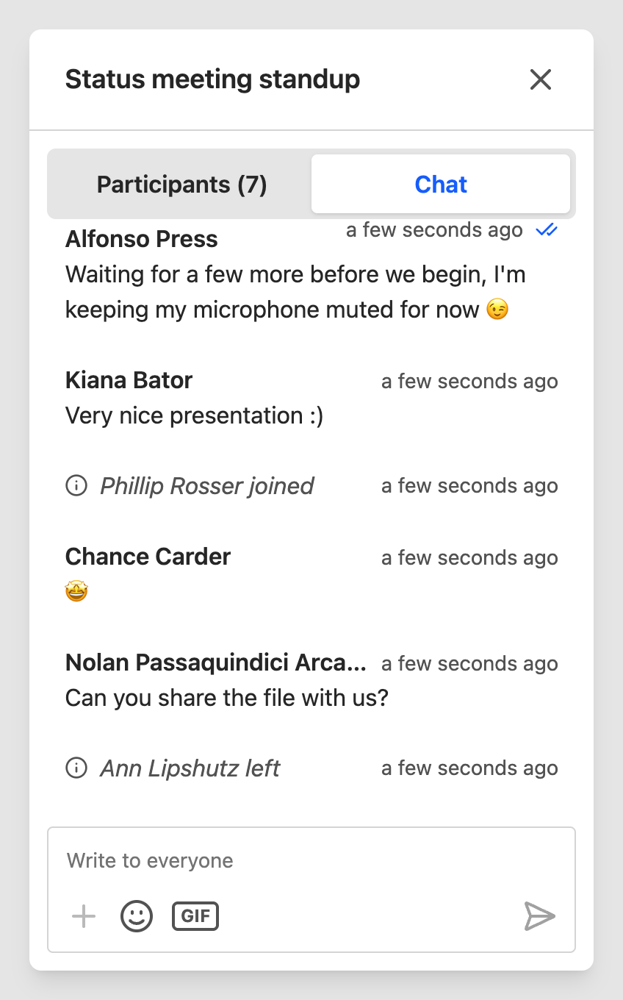
  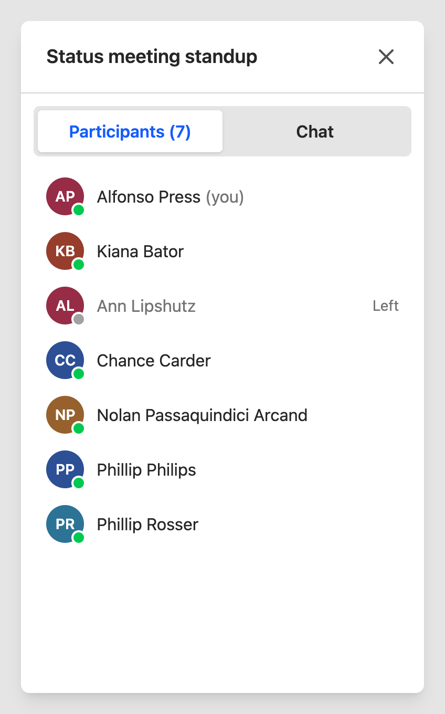
  
</p>

---

## Contents

1. [Overview](#overview)
2. [Quick Start](#quick-start)
3. [Architecture & Design Decisions](#architecture--design-decisions)
4. [Signaling: From Firebase to FastAPI](#signaling-from-firebase-to-fastapi)
5. [How Real-Time Messaging Works](#how-real-time-messaging-works)
6. [Multi-Participant Mesh](#multi-participant-mesh)
7. [Features & UI Details](#features--ui-details)
8. [Edge Cases & Performance at Scale](#edge-cases--performance-at-scale)
9. [End-to-End Encryption](#end-to-end-encryption)
10. [Message Protocol](#message-protocol)
11. [Testing & Benchmarking Strategy](#testing--benchmarking-strategy)
12. [Trade-Offs, Scope Boundaries & Known Issues](#trade-offs-scope-boundaries--known-issues)
13. [Development Timeline & Prioritization](#development-timeline--prioritization)

---

## Overview

| Area                | Implementation                                                                                                                                                                                                   |
| :------------------ | :--------------------------------------------------------------------------------------------------------------------------------------------------------------------------------------------------------------- |
| **Transport**       | WebRTC `RTCDataChannel` mesh (ordered, reliable SCTP (Stream Control Transmission Protocol) channels between every pair of peers)                                                                                |
| **Encryption**      | Ephemeral **ECDH (P-256)** key agreement per peer pair + **AES-GCM (256-bit)** per frame via Web Crypto API                                                                                                      |
| **Signaling**       | FastAPI WebSocket server (`signal-svc`) for room discovery and SDP handshakes; legacy Firebase Firestore backend still available at `/old`                                                                       |
| **State & Storage** | Zustand state management/store split into `roomSlice` and `chatSlice`, persisted locally per room in **IndexedDB**                                                                                               |
| **Performance**     | Virtualized message list (`@tanstack/react-virtual`) holding **60 fps** at **10,000–20,000 messages** (0.08 s room open, ~6 ms local peer-to-peer delivery)                                                      |
| **Rich Messaging**  | Edit & delete own messages, typing indicators, read receipts, emoji picker, Giphy search, inline image rendering, and server-fetched OpenGraph link previews                                                     |
| **Testing & CI**    | **120 automated tests** (67 Vitest unit tests, 19 pytest backend tests, 34 Playwright E2E tests in real Chrome) at **97% line coverage**, plus a dedicated Playwright load-testing and matplotlib plotting suite |

---

## Quick Start

### One-Command Startup (Docker)

Requires **Docker** and **Docker Compose**.

```bash
make up               # builds and starts signal-svc on :8080 and the web app on :3000
make logs             # tails logs from both containers
make down             # stops and removes containers
```

Open **http://localhost:3000** in two or more browser windows, enter a display name in each, create a room in one window, and join it from the others.

- **API Docs & Healthcheck:** FastAPI serves interactive OpenAPI documentation at **http://localhost:8080/docs** and a health check at **http://localhost:8080/health**.
- **Optional Giphy Support:** To enable GIF search in the composer, add `VITE_GIPHY_API_KEY=<your_key>` to `client/.env.local` before running `make up`. Without a key, the GIF button disables itself cleanly while everything else works.

### Local Development

Requires **Node 24+**, **Python 3.12+**, and **[uv](https://docs.astral.sh/uv/)**.

```bash
make install          # sets up signal-svc/.venv, git pre-commit hooks, and client/node_modules

# Terminal 1 — FastAPI signaling server (:8080)
cd signal-svc
make dev

# Terminal 2 — Vite dev server (:5173)
cd client
npm run dev
```

Visiting `/` uses the local FastAPI signaling server. Visiting `/old` uses the original Firebase Firestore signaling backend and requires no local backend process.

### Running Tests, Linting & Benchmarks

```bash
make test             # runs pytest, Vitest unit tests, and Playwright E2E suite

# Client suites
cd client
npm test              # 67 unit tests (Vitest)
npx playwright install chromium   # first-time browser setup if not already installed
npm run test:e2e      # 34 E2E tests in real Chrome (automatically boots both servers)
npm run lint          # TypeScript typecheck, ESLint, and Prettier
npm run load-test     # runs performance benchmarks into docs/data/ and captures screenshots

# Signaling server suites
cd signal-svc
make test             # 19 unit & WebSocket tests (pytest)
make coverage         # pytest with terminal coverage report
make lint             # ruff check & format check
```

To regenerate the benchmark charts in `docs/images/` from the JSON data in `docs/data/`, run `make plots`.

---

## Architecture & Design Decisions

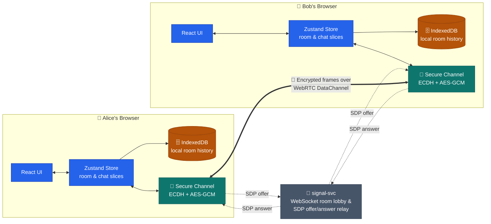

### Why Peer-to-Peer WebRTC Over a Central Relay?

Real-time chat architectures generally fall into two camps:

1. **Client-Server Relay (WebSocket / SSE):** Every client connects to a central server that receives, orders, stores, and broadcasts messages.
2. **Peer-to-Peer Mesh (WebRTC DataChannels):** A signaling channel introduces browsers to one another, after which every pair communicates directly over an `RTCDataChannel`.

I chose the **Peer-to-Peer WebRTC DataChannel mesh** because it keeps the server completely out of the data path. Once peers finish their SDP handshake, `signal-svc` carries zero conversation traffic. That makes end-to-end encryption natural—each pair negotiates an ephemeral key directly over the channel—and eliminates server-side message storage.

The trade-off is deliberate: in a full mesh, connection count grows quadratically with room size ($N(N-1)/2$), offline delivery isn't possible without a store-and-forward server, and peers behind symmetric NATs need a TURN relay if direct STUN hole-punching fails.

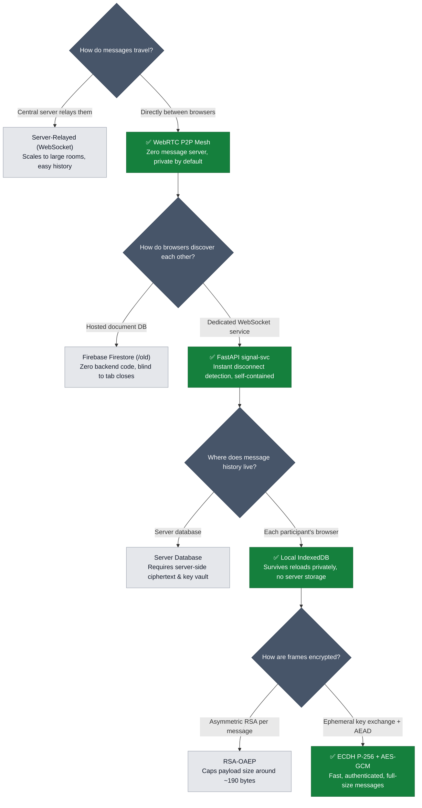

## Signaling: From Firebase to FastAPI

### Phase 1: Firebase Firestore (`/old`)

The initial version leveraged Firebase Firestore's real-time capabilities as the signaling mechanism for exchanging WebRTC SDP (Session Description Protocol) messages between peers.

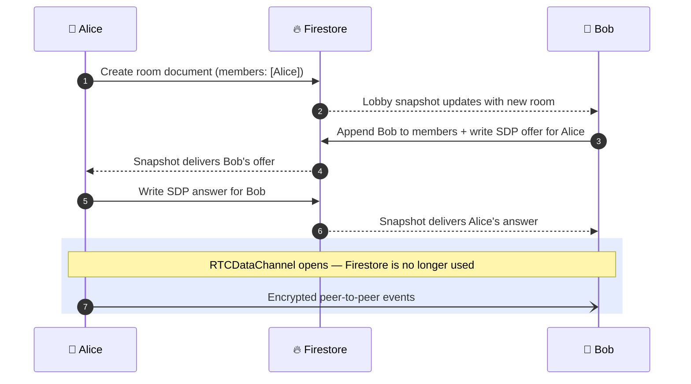

While Firestore got two browsers talking quickly, it exposed a fundamental limitation:

**a database only knows what a client writes—it cannot detect when a browser tab closes**.

- When a user closed their laptop,
- their room and membership entry stayed in Firestore forever,
- leaving ghost rooms in the lobby.

**To clean it up requries:**

1. Polling heartbeat checks.
2. TTL timestamps for room
3. Background corn to remove them.

### Phase 2: Custom FastAPI Signaling (`signal-svc`)

Signaling Service was introduced to handle peer discovery, SDP negotiation, and ICE candidate exchange.

> Its responsibility is limited to facilitating connection establishment between clients. Once the WebRTC connection is successfully established, peers communicate directly through their DataChannels.

Each browser opens a single persistent WebSocket to `ws://localhost:8080/api/v1/signaling/ws`:

1. **Live Lobby:** Active rooms are held in memory; whenever a room is created or emptied, the updated list broadcasts to connected clients. It fixes that problem with the firebase one.
2. **Addressed Handshakes:** When a newcomer joins a room, the server returns the list of existing peer IDs (`joined`) and routes targeted `offer` and `answer` messages between pairs.
3. **Automatic Cleanup:** When a client's WebSocket disconnects, `signal-svc` immediately removes that peer from its room and prunes the room as soon as the last participant leaves.

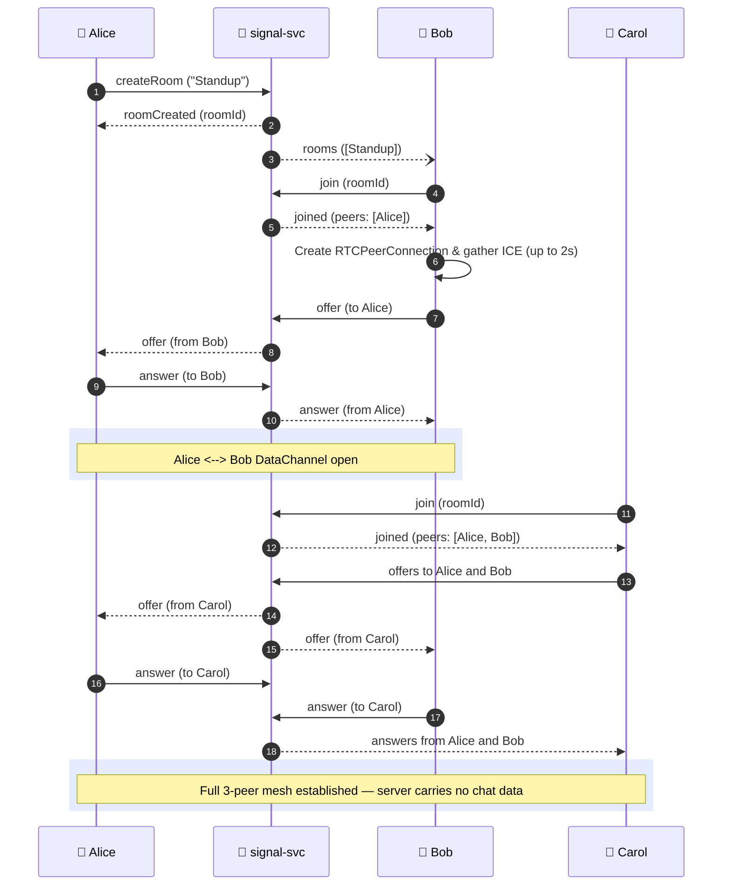

> Notice the glare-prevention rule: **the newcomer always initiates the offers**, and existing room members always answer. Two browsers never send competing offers to each other simultaneously.

#### Signaling Wire Events

| Direction       | `type`             | Payload Fields            | Description                                                                                                                                           |
| :-------------- | :----------------- | :------------------------ | :---------------------------------------------------------------------------------------------------------------------------------------------------- |
| Client → Server | `createRoom`       | `name`                    | Creates a new room and joins the creator to it                                                                                                        |
| Client → Server | `join`             | `roomId`                  | Joins an existing room                                                                                                                                |
| Client → Server | `offer`            | `roomId`, `peerId`, `sdp` | Forwards an SDP offer to a specific peer in the room                                                                                                  |
| Client → Server | `answer`           | `roomId`, `peerId`, `sdp` | Forwards an SDP answer back to the offering peer                                                                                                      |
| Server → Client | `rooms`            | `rooms`                   | Broadcasts active rooms on connect and whenever the lobby changes                                                                                     |
| Server → Client | `roomCreated`      | `room`                    | Confirms room creation with its generated `id` and `name`                                                                                             |
| Server → Client | `joined`           | `roomId`, `peers`         | Returns the IDs of peers already inside the room                                                                                                      |
| Server → Client | `offer` / `answer` | `roomId`, `peerId`, `sdp` | Delivers an offer/answer along with the sender's `peerId`                                                                                             |
| Server → Client | `error`            | `message`                 | Validation or state refusal (`Invalid message`, `Room not found`, `You are already in this room`, `You are not in this room`, `That person has left`) |

---

## How Real-Time Messaging Works

### Life of a Message

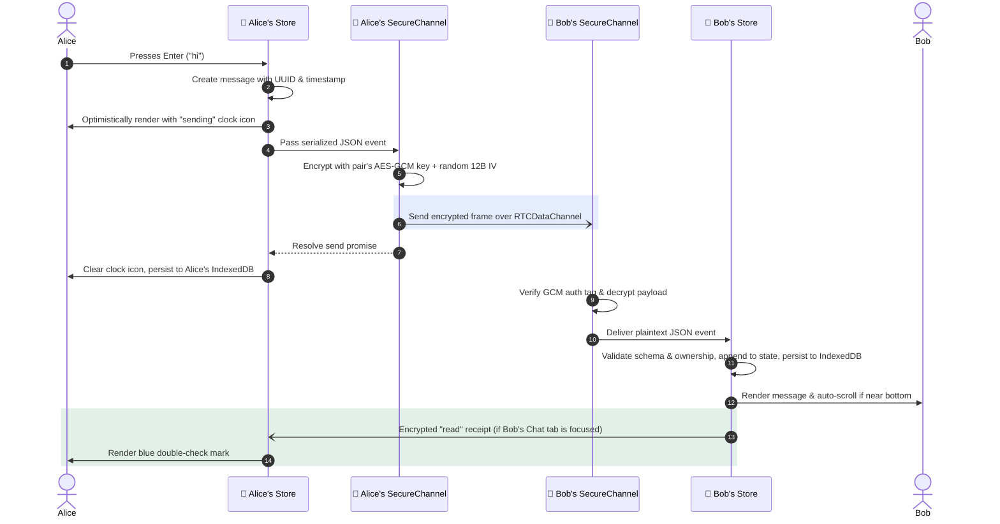

1. **Optimistic UI with honest delivery state:** Your message renders immediately with a subtle clock icon (`sending: true`). Once the encrypted frame has been handed to every open peer channel, the clock clears.
2. **Ordered, reliable channels:** WebRTC data channels run in their default ordered/reliable SCTP mode, guaranteeing in-order delivery per peer pair.
3. **Zero-trust receiver validation:** Before mutating state, the receiving store checks that edits and deletes come from the original message's `userId` and ignores unknown or local-only event types.

### Measured Latency

Measured across 200 back-to-back messages and 15 join/leave cycles between real Chrome windows on the same machine (`client/test/load-test/realtime.spec.ts`):


- **Message delivery:** **6 ms median** end-to-end (encrypt → WebRTC SCTP data channel → decrypt → React render), **11 ms p95**, **13 ms max**.
- **Disconnect detection:** Closing a tab displays _"left"_ on every remaining peer's screen in **~6 ms**.
- **Room join / rejoin:** **~155 ms** from clicking Join to completing the SDP + ECDH handshake (`~148 ms` on rejoin).

---

## Multi-Participant Mesh

Rooms support multiple simultaneous participants via a full peer-to-peer mesh. When a newcomer joins a room of $N$ existing members, they open $N$ independent `RTCPeerConnection` instances (each with a negotiated data channel and its own ephemeral ECDH key pair).

And Thus We have problem, number of connection = N x (N - 1)

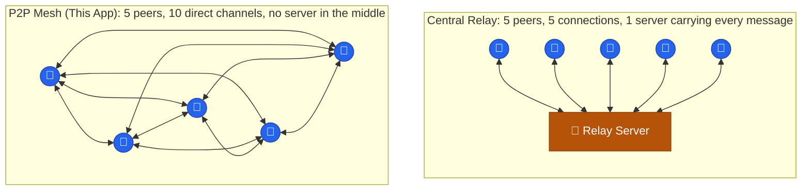

| Participants in Room              |  2  |  3  |  5  | 7 (Tested E2E) | 12  |
| :-------------------------------- | :-: | :-: | :-: | :------------: | :-: |
| **Direct Channels in Mesh**       |  1  |  3  | 10  |     **21**     | 66  |
| **Connections via Central Relay** |  2  |  3  |  5  |       7        | 12  |

The current architecture has been tested with **2–7 concurrent participants** in a local browser environment, using automated Playwright tests.

In this setup, the full-mesh P2P architecture achieves approximately 6 ms latency, with zero application-server bandwidth consumption for peer-to-peer message exchange.

> However, these results are based on a controlled local environment.

In real-world network conditions, several factors will significantly influence performance and scalability:

- **Network latency:** Geographical distance, routing, and network congestion between peers.
- **Bandwidth constraints:** Upload/download capacity and network quality of individual participants.
- **Connection complexity:** The \(O(N^2)\) growth in peer connections as the number of participants increases.
- **Encryption overhead:** Each peer maintains separate DTLS connections, introducing additional encryption and processing overhead.
- **Network reliability:** NAT traversal, packet loss, and connectivity differences across networks.
  Potential Solutions.

To address these limitations and support larger group conversations, two alternative infrastructure components could be introduced:

1. **SFU (Selective Forwarding Unit)**

A centralized media/data forwarding server that receives incoming streams or packets and selectively forwards them to their intended recipients.

- Reduces the number of direct peer connections.
- Offloads connection management from individual clients.
- Provides better scalability for larger group sessions.
- Introduces server-side bandwidth and infrastructure costs.

2. **Relay Server**

A relay server acts as an intermediary when direct peer-to-peer connectivity is unavailable or unreliable.

- Forwards traffic between peers when direct connectivity fails.
- Helps overcome restrictive NAT and firewall configurations.
- Can improve connection reliability across different network environments.
- Introduces additional network hops, latency, and **bandwidth costs** as 100% packets routes through server.

Architectural consideration: An SFU and a relay server solve related but different problems.

- An SFU is an application-level forwarding architecture.
- TURN relay primarily provides connectivity when direct ICE paths cannot be established.

---

## Features & UI Details

### Presence (`joined`, `left`, `rejoined`)

<p align="center">
  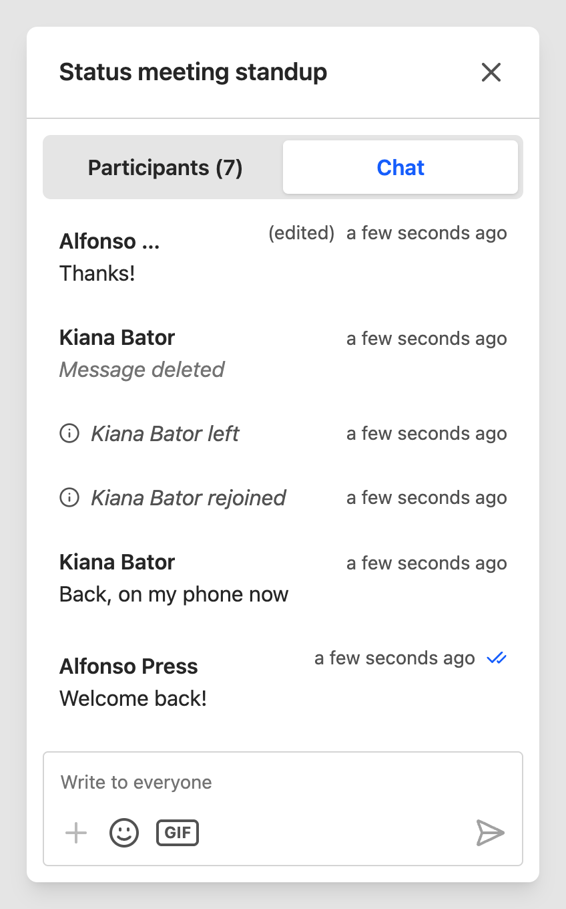
  
</p>

### Editing & Deleting Own Messages

<p align="center">
  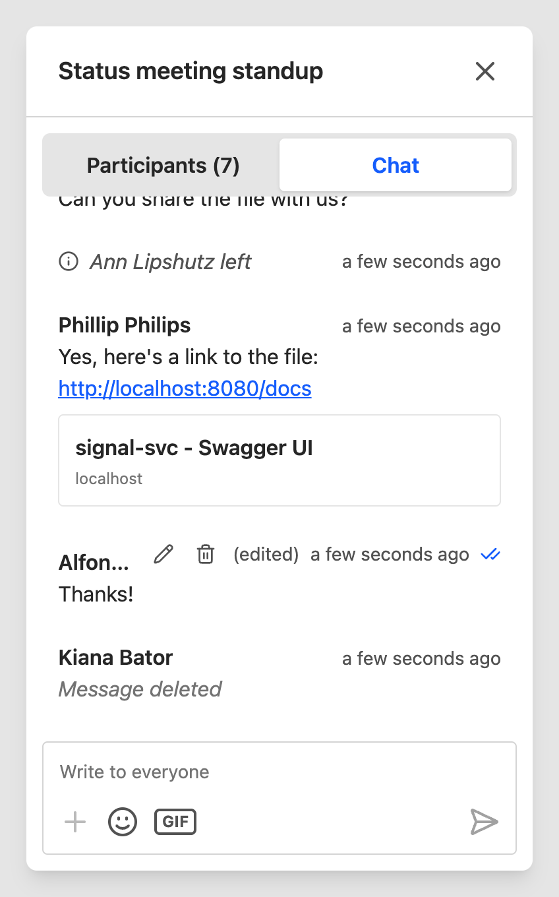
</p>

Hovering over (or tabbing to) your own message reveals **Edit** and **Delete** actions (always visible on touch devices):

**Ownership enforcement:**

Each browser tab generates a persistent `userId` UUID in `sessionStorage`. Even if someone crafts a raw `edited` or `deleted` frame for another user's message, receivers verify `incoming.userId === original.userId` before applying it.

### Typing Indicators & Read Receipts

<p align="center">
  
</p>

- **Typing:** Keystrokes in the composer emit a `typing` event throttled to at most once every **2 seconds**. Receivers display _"<Name> is typing…"_ for **3 seconds** or clear it immediately when a message from that user arrives.
- **Read Receipts:** When a message from another participant is visible while the browser window is focused and the **Chat** tab is active, the client sends a `read` event referencing that message ID. The sender's UI advances a high-water mark (`seenId`) and renders a blue double-check icon—ignoring out-of-order receipts from slower readers so the indicator never moves backward.

### Rich Content: Emoji Picker, Link Previews & Giphy

<p align="center">
  
</p>

### UI Polish & Intentional Improvements Over the Initial Mockup

<p align="center">
  
  
  
</p>

---

## Edge Cases & Performance at Scale

### 1. Participant Disconnects and Reconnects

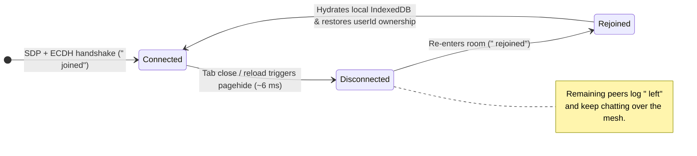

1. **Over the wire:** When a peer connects (or reconnects), they always send { type: "joined", userName: name }.
2. **In the receiving store:** When joined arrives, the receiver checks whether its events list already contains a left event for that userName:

```js
const hasLeft = events.some(
  (e) => e.type === "left" && e.userName === event.userName,
);
addEvent({
  type: hasLeft ? "rejoined" : "joined",
  userName: event.userName,
  createdAt: Date.now(),
});
```

3. **In the UI**: It renders the system show "rejoined".

<p align="center">
  
</p>

**More edge cases to handle:**

- **Offline gap:** Returning peers only load their own local IndexedDB snapshot and miss any messages, edits, or deletes sent while they were away.
- **New tab vs. reload:** `userId` lives in tab-scoped `sessionStorage`, so rejoining from a brand-new tab loads old messages from IndexedDB but loses edit/delete ownership over them.
- **Name-based matching:** `rejoined` checks `userName` rather than `userId`, so a new user with the same name triggers `"rejoined"`, while a returning user who changes their name stays listed as `"Left"`.
- **Unsaved presence history:** `joined`/`left` events are not stored in IndexedDB, so after a reload a peer cannot tell if someone else had previously left and rejoined.
- **Last peer refresh:** `signal-svc` deletes a room when its last socket closes, so if everyone refreshes at once the `roomId` is lost and its IndexedDB history becomes unreachable.
- **Stale channel race:** After an abrupt crash (no `pagehide`), rejoining before the dead WebRTC channel times out can trigger a delayed `"left"` event when the old channel finally closes.

### 2. New Participant Joins & Message History

Each browser persists its own encrypted room transcript locally in **IndexedDB** (`client/src/libs/indexdb.ts`).

- **Returning participant:** Sees every message from their prior session in that room.
- **Brand-new participant:** Starts with a clean slate from the moment they join. Because there is no central message database, historical messages are not fetched from the server, and messages sent while a user is completely offline are not queued for later delivery.

### 3. Handling 10,000+ Messages (Virtualization & Benchmarks)

#### Before Virtualization

Rendering 10,000 messages directly into the DOM created **78,828 DOM nodes**, ran a `setInterval` timestamp refresh across all 10,000 rows every second, and forced layout recalculations whenever a new message arrived:

<p align="center">
  
</p>

At 10,000 messages, idle frame rate dropped to **11 fps**, new messages took **1.57 seconds** to appear, and at 20,000 messages the UI froze at **1.4 fps**.

#### After Virtualization (`@tanstack/react-virtual`)

I replaced the raw list with a dynamic-height virtualizer in `MessageList.tsx` that mounts only the visible viewport rows plus an 8-row overscan buffer above and below, while maintaining scroll-to-bottom pinning on new messages and surfacing a floating _"Jump to newest"_ button when scrolled up.

<p align="center">
  
</p>

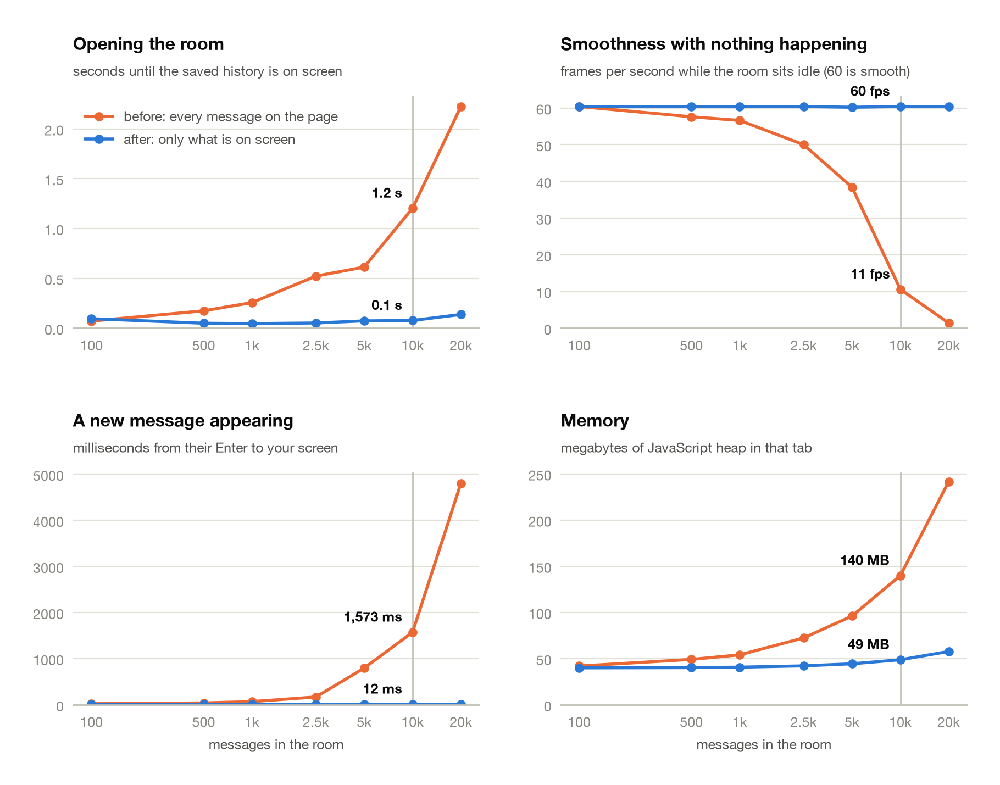

| Messages (`Before / After`) |      Room Open Time |    Idle FPS | Incoming Message Render |     JS Heap Memory |     DOM Elements |
| --------------------------: | ------------------: | ----------: | ----------------------: | -----------------: | ---------------: |
|                         100 |     0.07 s / 0.10 s |     60 / 60 |           24 ms / 13 ms |      42 MB / 40 MB |        937 / 181 |
|                       1,000 |     0.26 s / 0.05 s |     57 / 60 |           69 ms / 12 ms |      54 MB / 41 MB |      7,877 / 170 |
|                       5,000 |     0.61 s / 0.07 s |     38 / 60 |          796 ms / 13 ms |      96 MB / 44 MB |     39,731 / 188 |
|                  **10,000** | **1.20 s / 0.08 s** | **11 / 60** |    **1,573 ms / 12 ms** | **140 MB / 49 MB** | **78,828 / 166** |
|                      20,000 |     2.22 s / 0.14 s |    1.4 / 60 |        4,802 ms / 13 ms |     242 MB / 58 MB |    157,209 / 177 |

---

## End-to-End Encryption

Every event sent over a data channel (`sent`, `edited`, `deleted`, `joined`, `typing`, `read`) is encrypted end-to-end using the browser's native **Web Crypto API** (`crypto.subtle`)—zero third-party crypto dependencies.

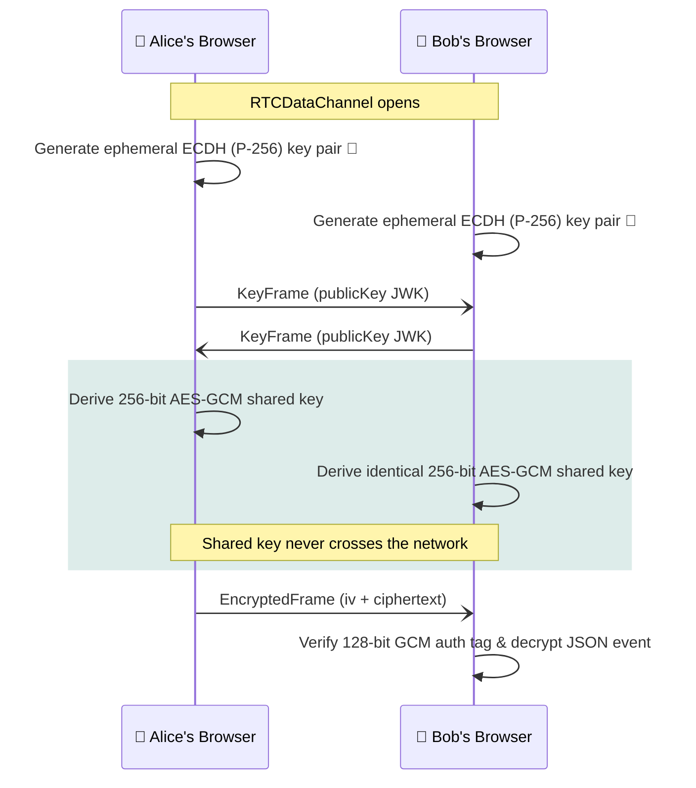

- **Forward secrecy per session:** Ephemeral ECDH P-256 key pairs live only in memory for the duration of a single data channel.
- **Authenticated encryption:** Every outbound frame generates a fresh 12-byte random IV via `crypto.getRandomValues` and encrypts the JSON event with `AES-GCM`. Any bit-flip or tampering fails GCM authentication tag verification and drops the frame.
- **Ordered async queues:** `secureChannel.ts` serializes outbound encryption and inbound decryption through promise queues, and buffers any events queued before the ECDH handshake completes so nothing arrives out of order.

### Payload Size Limit & Invalid Message Handling


| Case | Example | What Happens |
| :--- | :--- | :--- |
| **Valid message** (`≤ 123,631 bytes`) | `"See you at 10! 👋"` or a 100 KB text snippet (~30,900 emoji max) | Encrypts in ≤1.4 ms, sends `{ type: "encrypted", iv, data }` (~1.33× size in base64), clears the sender's clock icon, and decrypts in ≤3.1 ms on the receiver. |
| **Invalid outbound: Oversized** (`> 123,631 bytes`) | A 150,000-character log paste (`> 30,907` 4-byte emoji) | `toBase64` overflows the call stack (`RangeError`), `secureChannel.send()` resolves `false`, no frame leaves the browser, and the message stays stuck with the clock icon (`sendingIds`), while smaller messages sent afterward still go through. |
| **Invalid inbound: Tampered / wrong key** | Modified `iv`/`data` bytes in transit or a frame encrypted with another key | `crypto.subtle.decrypt` fails the 128-bit GCM auth tag check and throws; `secureChannel` catches and drops the frame without touching the store. |

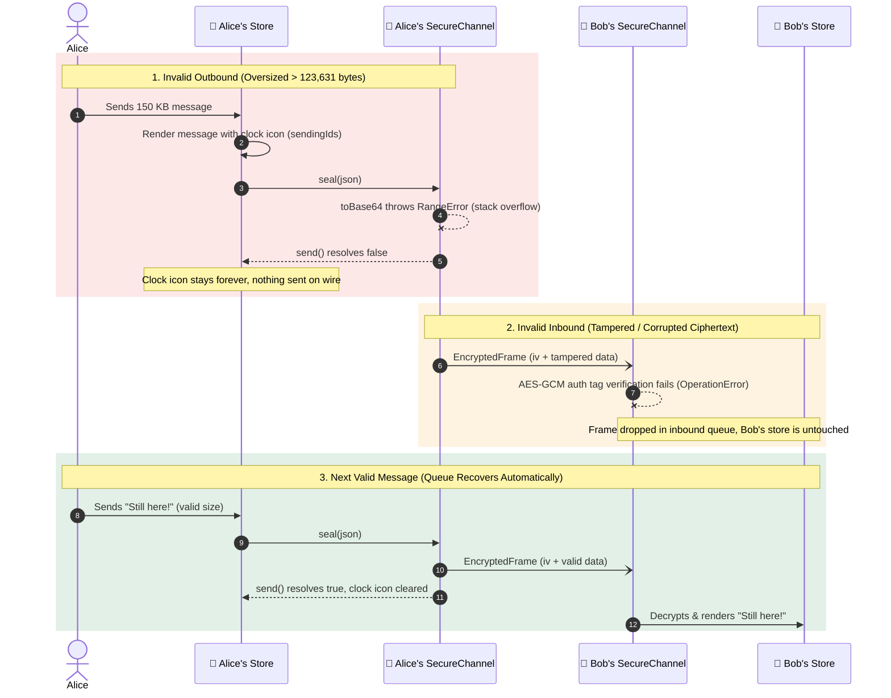

---

## Message Protocol

All peer-to-peer communication happens over `RTCDataChannel` using two outer wire frames (`client/src/types/frames.ts`):

| Wire Frame `type` | Fields                       | Purpose                                                                                    |
| :---------------- | :--------------------------- | :----------------------------------------------------------------------------------------- |
| `key`             | `publicKey: JsonWebKey`      | Sent once in plaintext when a data channel opens to exchange ECDH P-256 public keys        |
| `encrypted`       | `iv: string`, `data: string` | Base64-encoded 12-byte IV and AES-GCM ciphertext+tag wrapping a single JSON protocol event |

### Decrypted Event Types (`client/src/types/events.ts`)

| `type`     | Category | Sent on Wire? | Description                                                                          |
| :--------- | :------- | :-----------: | :----------------------------------------------------------------------------------- |
| `sent`     | Chat     |      Yes      | New chat message                                                                     |
| `edited`   | Chat     |      Yes      | Replaces text of an existing message with matching `id` and `userId`                 |
| `deleted`  | Chat     |      Yes      | Clears text of an existing message with matching `id` and `userId`                   |
| `joined`   | Room     |      Yes      | Sent once per peer connection after ECDH key agreement completes                     |
| `left`     | Room     |  No (Local)   | Generated locally when a peer's data channel closes                                  |
| `rejoined` | Room     |  No (Local)   | Generated locally instead of `joined` when a previously disconnected name reconnects |
| `typing`   | Presence |      Yes      | Ephemeral typing notification (throttled to 1 per 2s)                                |
| `read`     | Presence |      Yes      | High-water mark read receipt referencing the latest seen `messageId`                 |

### Event Payloads

**New message (`sent`):**

```json
{
  "type": "sent",
  "sessionId": "room-uuid",
  "payload": {
    "message": {
      "id": "6f1c9a10-...",
      "userId": "a93e4b21-...",
      "userName": "Alice",
      "text": "Hello everyone!",
      "createdAt": 1763078400000
    },
    "metadata": {}
  }
}
```

**Edited and deleted messages (`edited` / `deleted`):**

```json
{
  "type": "edited",
  "sessionId": "room-uuid",
  "payload": {
    "message": {
      "id": "6f1c9a10-...",
      "userId": "a93e4b21-...",
      "userName": "Alice",
      "text": "Hello everyone! (updated)",
      "createdAt": 1763078400000,
      "editedAt": 1763078460000
    },
    "metadata": {}
  }
}
```

```json
{
  "type": "deleted",
  "sessionId": "room-uuid",
  "payload": {
    "message": {
      "id": "6f1c9a10-...",
      "userId": "a93e4b21-...",
      "userName": "Alice",
      "text": "",
      "createdAt": 1763078400000,
      "deletedAt": 1763078520000
    },
    "metadata": {}
  }
}
```

**Room & presence events (`joined` / `typing` / `read`):**

```json
{ "type": "joined", "userName": "Bob" }
{ "type": "typing", "userName": "Bob" }
{ "type": "read", "messageId": "6f1c9a10-..." }
```

---

## Testing & Benchmarking Strategy

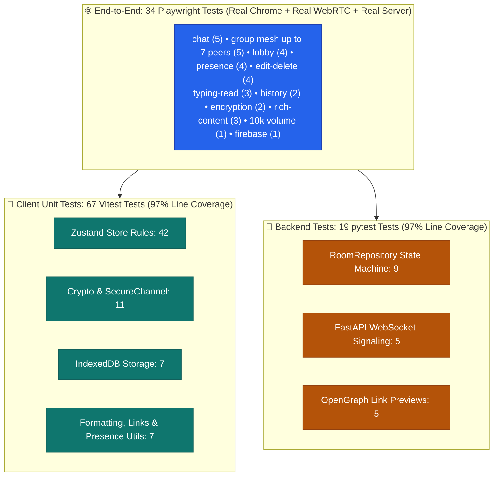

1. **Fast domain verification in unit tests:** The Zustand store, ECDH/AES-GCM primitives, and `RoomRepository` are tested directly in Node/pytest with fake transports and clocks. This makes edge cases—like forged `userId` edits, tampered ciphertext tags, out-of-order read receipts, or failed IndexedDB writes—trivial to test deterministically.
2. **Real-browser integration in Playwright:** All 34 E2E tests spin up real Chrome instances, connect through `signal-svc`, negotiate WebRTC data channels, and verify user-visible behavior across 2 to 7 concurrent browser contexts.
3. **Bugs caught by the test suite during development:**
   - **Silent tab close:** Closing a peer tab in Playwright originally left the other browser waiting indefinitely because Chrome tore down the page before SCTP sent a close chunk. Adding a `pagehide` listener brought disconnect detection down to ~6 ms.
   - **3-peer ICE gathering race:** A 3-person room initially failed to connect ~1 in 6 runs because `iceCandidatePoolSize` interacted poorly with on-demand peer connections. Removing the stale pool setting resulted in 40/40 consecutive passes.
   - **123 KB base64 stack overflow & 10k-message DOM freeze:** Both were exposed by the automated load-test suite in `client/test/load-test/` and locked down with regression tests.

---

## Trade-Offs, Scope Boundaries & Known Issues

### Intentional Scope Boundaries

Several potential additions were evaluated and intentionally left out to keep the architecture cohesive:

- **Server-side REST message history with pagination:** A paginated `GET /api/v1/rooms/{id}/messages?before=<cursor>&limit=50` endpoint requires the server to store conversation history. Because the core premise of this architecture is a zero-knowledge signaling server that never stores or sees messages, history lives in client-side IndexedDB instead.
- **Server-side AI features (summarization / moderation):** Running server-side LLMs on chat history would require breaking end-to-end encryption or exfiltrating plaintext to an external API.
- **Multi-theme design system:** The UI uses clean Tailwind utility classes tuned to the target light layout rather than abstracting a multi-theme token layer for a single-view app.
- **Binary file upload:** Inline image/GIF URLs and OpenGraph cards are supported, while raw file upload (which requires chunking files into <64 KB SCTP frames, backpressure handling, and reassembly progress bars) is left out; the `+` attachment icon remains disabled as a placeholder.

### Known Issues & Trade-Offs

| #     | Limitation                                                                 | Root Cause & Planned Fix                                                                                                                                                                                                                                                              |
| :---- | :------------------------------------------------------------------------- | :------------------------------------------------------------------------------------------------------------------------------------------------------------------------------------------------------------------------------------------------------------------------------------ |
| **1** | **Newcomers see no prior messages; offline peers miss messages**           | History lives only in each browser's IndexedDB. _Next step:_ Have an existing peer sync recent encrypted room history to newcomers upon channel open.                                                                                                                                 |
| **2** | **Concurrent messages can appear in different orders across peers**        | Live messages append in arrival order, whereas reloaded history sorts by sender `createdAt` wall clock. _Next step:_ Use a Lamport timestamp / per-room sequence counter.                                                                                                             |
| **3** | **Messages over ~123 KB stay stuck on the clock icon**                     | `btoa(String.fromCharCode(...bytes))` overflows the call stack, and WebRTC caps single SCTP messages at 256 KB. _Next step:_ Encode base64 in chunks and split large payloads across multiple frames.                                                                                 |
| **4** | **Unauthenticated ECDH public keys**                                       | Keys are exchanged over the signaling path without out-of-band verification, so a compromised signaling server could MITM the handshake. _Next step:_ Display a safety number / key fingerprint digest for peers to compare.                                                          |
| **5** | **Silent errors when alone in a room or when `signal-svc` is unreachable** | Pressing Send with 0 connected peers leaves the draft in the input without a toast, and the WebSocket client doesn't auto-reconnect if `signal-svc` restarts. _Next step:_ Disable Send with a _"Waiting for participants…"_ hint and add exponential-backoff WebSocket reconnection. |
| **6** | **Abrupt network drop / browser crash detection is slow**                  | Graceful tab closes trigger `pagehide` (~6 ms), but a hard crash or unplugged cable relies on SCTP/ICE timeouts (>60 s) and lacks application-level delivery ACKs. _Next step:_ Monitor `iceConnectionState` and add lightweight heartbeats + per-message ACK frames.                 |
| **7** | **STUN-only connectivity & in-memory signaling state**                     | Strict symmetric NATs require a TURN relay, and `signal-svc` keeps rooms in a single process's memory without auth, rate limiting, or SSRF IP filtering on `/api/v1/previews`.                                                                                                        |
| **8** | **Group typing & read receipt granularity**                                | `seenId` tracks that _at least one_ peer read the message rather than listing which members saw it, and the typing banner displays one active typist at a time.                                                                                                                       |

---

## Development Timeline & Prioritization

Total development time was **~6.5–7 hours**.

| Priority                                           | Time Allocated | Focus & Deliverables                                                                                                                                                                 | Why We Prioritized It Here                                                                                                                                                |
| :------------------------------------------------- | :------------: | :----------------------------------------------------------------------------------------------------------------------------------------------------------------------------------- | :------------------------------------------------------------------------------------------------------------------------------------------------------------------------ |
| **1. WebRTC MVP with Firebase as Realtime events** |    ~45 min     | WebRTC `RTCDataChannel` connection, initial Firestore signaling, prototype UI, and automatic peer reconnect                                                                          | Tackled the biggest technical unknown first—proving two browsers could discover each other and exchange messages directly before investing in state or polish.            |
| **2. State Management and Tests**                  |    ~1h 15m     | State Management, room lobby, multi-user presence, message edit & delete with ownership enforcement, and initial unit and E2E tests                                                  | State Management was required for managing complex local chat along with edit and delete functionality sent over data channel.                                            |
| **3. Signaling Service**                           |    ~45 min     | A FastAPI webSocket server for SDP                                                                                                                                                   | Replacing FireBase and adding signaling svc for sending offer/answer. `/old` still can use firebase one, that cannot track tab closed.                                    |
| **4. Real-Time UX, Accessibility & CI**            |    ~1h 15m     | Typing indicators, read receipts, emoji picker, OpenGraph link previews, Giphy search, mobile layout, empty-state motion graphics, Docker Compose (`make up`), and GitHub Actions CI | With signaling and store boundaries stable, we added user-facing polish and automated CI gates so every subsequent architectural change was continuously verified.        |
| **5. Privacy, Persistence & Scale**                |    ~2h 10m     | IndexedDB local history, end-to-end encryption (ECDH P-256 + AES-GCM `secureChannel`), 10k+ message virtualization (`@tanstack/react-virtual`), and multi-participant mesh rooms     | Because transport was cleanly decoupled in Stage 2, slotting encryption, persistence, virtualization, and N-way mesh underneath required minimal changes to upper layers. |
| **6. Load Benchmarking, Refactor & Docs**          |    ~30 min     | Playwright load-test harness (latency, 20k-message FPS, 123 KB crypto ceiling), matplotlib charts, `libs/rtc/` module split, and architecture documentation                          | Measured real system limits on the finished stack rather than guessing, turned findings into regression tests, and documented trade-offs with empirical data.             |

---
