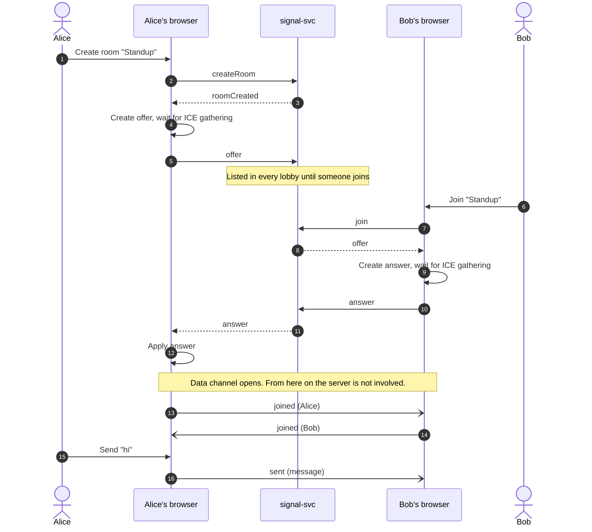
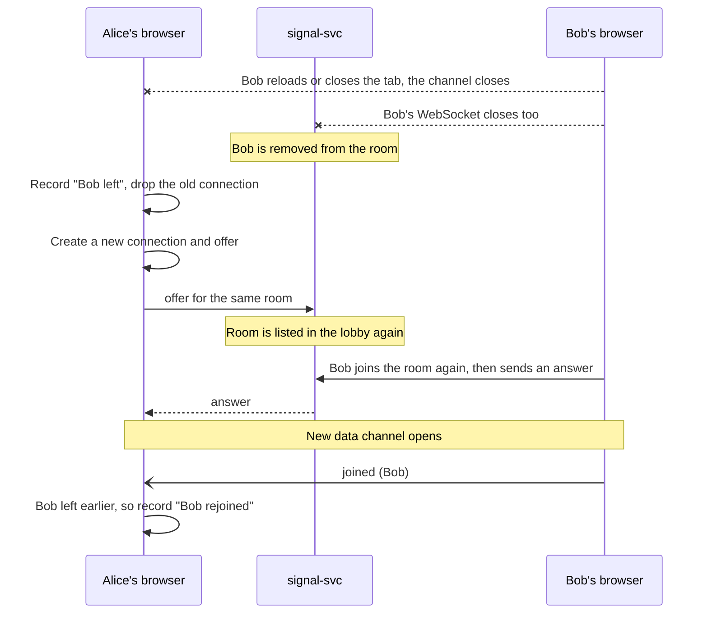
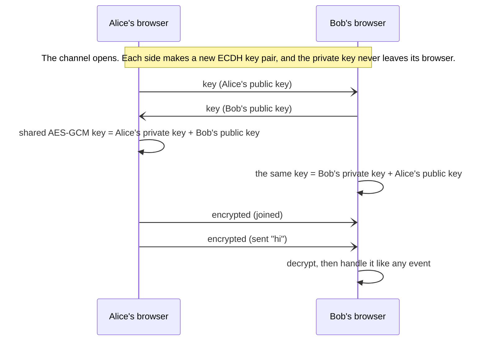
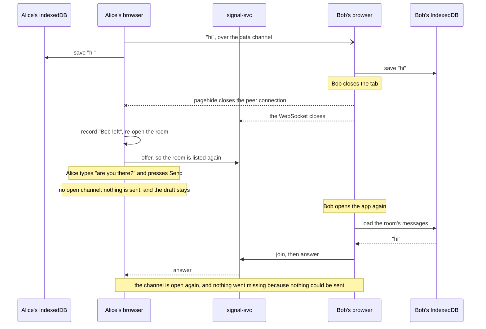
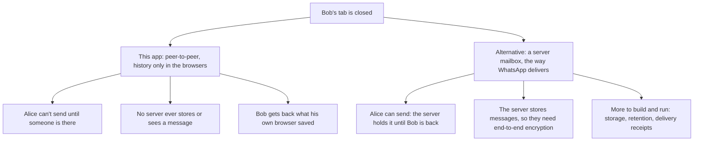

# Realtime Chat

Peer-to-peer chat built with React, TypeScript and WebRTC data channels.

## Getting started

### One command, with Docker

```bash
make up               # builds and starts signal-svc on :8080 and the app on :3000
make logs             # follows both
make down             # stops and removes them
```

Open http://localhost:3000 in two tabs or on two devices. Enter a name, create a room in one, and join it from the other.

GIF search needs a [Giphy API key](https://developers.giphy.com). Put `VITE_GIPHY_API_KEY=<key>` in `client/.env.local` and `make up` passes it to the app's build; without one, the GIF button is disabled.

### Local development

You need Node 24, Python 3.12 and [uv](https://docs.astral.sh/uv/).

```bash
make install          # signal-svc's .venv and the git pre-commit hook, then the client's node_modules

cd signal-svc
make dev              # FastAPI signaling server on :8080

cd client
npm run dev           # app on :5173
```

- **`/`** uses the FastAPI signaling server (`signal-svc`).
- **`/old`** uses the earlier Firebase signaling and needs no local server.

Tests and linting:

```bash
make test             # everything below: signal-svc's tests, the client's unit tests and the e2e suite

cd client
npm test              # unit tests (Vitest)
npm run test:e2e      # end-to-end tests (Playwright); starts signal-svc and the app itself
npm run lint          # tsc, ESLint and Prettier
npm run format        # Prettier, writes the fixes

cd signal-svc
make test             # room logic unit tests, plus WebSocket tests through FastAPI's TestClient (pytest)
make lint             # ruff check and format check
make format           # ruff, writes the fixes
```

Every commit runs [`.pre-commit-config.yaml`](.pre-commit-config.yaml): both `npm run lint` in `client/` and `make lint` in `signal-svc/`, whichever files changed, plus whitespace, YAML/TOML and private-key checks. If one fails, run that project's `format` and commit again. To run them by hand: `signal-svc/.venv/bin/pre-commit run --all-files`.

### CI

[`ci.yml`](.github/workflows/ci.yml) runs on every pull request and every push to `main`. It has these jobs:

- the pre-commit hooks;
- signal-svc's tests;
- the client's unit tests;
- the client build;
- the Playwright e2e suite;
- a `docker compose build`.

Both test jobs print a coverage report to the log and add a coverage table to the run's summary page; on pull requests the client's table is also posted as a comment. A final `CI Checks` job fails if any job failed or was skipped, so it is the one check to require on `main`.

## Architecture

I chose **peer-to-peer (option B)**: messages travel directly between the two browsers over a WebRTC data channel.


Solid lines carry chat traffic; dotted lines are only used while connecting.

### Why peer-to-peer

- **No server in the message path.** Chat messages, edits and deletes go straight from one browser to the other, so no server sees, stores or has to relay them.
- **The server stays small.** It only helps two browsers find each other; once they're connected it carries no chat traffic at all.
- **It's the brief's preferred option,** and it shows the parts of real-time communication that a relay hides: offers and answers, ICE, connection state, and what happens when a peer disappears.

### Signaling: a FastAPI server, with Firebase kept on `/old`

Two browsers need a shared place to swap a WebRTC offer and answer before they can talk directly. The app has two ways to do that, behind one small interface (`Signaling` in [`client/src/types/signaling.ts`](client/src/types/signaling.ts)). [`libs/signaling/index.ts`](client/src/libs/signaling/index.ts) picks one from the URL path, and the rest of the app doesn't know which it is using.

**`/`: `signal-svc`, a FastAPI WebSocket server** on asyncio and Uvicorn.

- **It's what the brief expects:** a lightweight signaling server, about 300 lines of Python.
- **It knows when people leave.** When a browser's WebSocket closes, the server removes it from its room, and a room whose host leaves before anyone joins disappears from every lobby straight away. The Firebase version can't tell, so abandoned rooms stay listed.
- **Nothing hosted, no keys.** It runs locally with `make dev`, or in Docker with `make up`.
- **Every message is validated.** Pydantic models describe each message ([`schemas/`](signal-svc/app/endpoints/v1/signaling/schemas)). Anything that doesn't match gets an `error` back instead of reaching the room logic.
- **The room logic is plain code.** `RoomRepository` returns a list of messages to send instead of touching sockets, so it's unit tested without a server. `SignalingHandler` only parses and delivers.

**`/old`: Firestore, the first version.** Each room is a document in `rooms/` holding its name, the offer and the answer. `onSnapshot` tells the host when the answer arrives, and the lobby lists rooms whose answer is still empty. I kept it to show that the signaling layer can be swapped without touching the store or the UI.

### Connecting a room



Both sides wait for ICE gathering to finish before sending, for at most 2 seconds, so each offer and answer already contains the network candidates. Without that cap, one slow reply from a STUN server could hold the offer back forever. That keeps signaling to one offer and one answer per connection, with no separate candidate exchange. The `/old` page follows the same steps, with Firestore reads and writes in place of the WebSocket messages.

### Leaving and rejoining



Alice never has to reload. Whoever stays in the room re-opens it for the next person, and when the last person leaves, the server deletes the room.

### Signaling protocol (`/`)

JSON messages over one WebSocket to `ws://localhost:8080/api/v1/signaling/ws`. They are defined in [`requests.py`](signal-svc/app/endpoints/v1/signaling/schemas/requests.py) and [`responses.py`](signal-svc/app/endpoints/v1/signaling/schemas/responses.py).

| Direction | Type | Fields | Meaning |
|---|---|---|---|
| client → server | `createRoom` | `name` | Register a new room. |
| client → server | `offer` | `roomId`, `sdp` | Store an offer; the room is listed until someone joins. |
| client → server | `join` | `roomId` | Ask for a waiting room's offer. |
| client → server | `answer` | `roomId`, `sdp` | Answer the offer; relayed to the room's host. |
| server → client | `rooms` | `rooms` | The rooms waiting for someone. Sent on connect and whenever the list changes. |
| server → client | `roomCreated` | `room` | Reply to `createRoom`. |
| server → client | `offer` | `roomId`, `sdp` | Reply to `join`. |
| server → client | `answer` | `roomId`, `sdp` | The guest's answer, sent to the host. |
| server → client | `error` | `message` | For example "Room is not available" when a second guest tries to join. |

## Project structure

```
client/src/
  App.tsx              page frame: lobby or room
  components/
    Header.tsx         title and leave button
    Lobby.tsx          name, room list, create room
    ChatRoom.tsx       tabs, participants, messages, composer, read receipts
    MessageList.tsx    messages, join/leave rows, scrolling to the newest
    MessageItem.tsx    one message: editing your own, sending and seen ticks
    MessageForm.tsx    composer with the emoji and GIF pickers
    GifPicker.tsx      Giphy search
    LinkPreview.tsx    a card for the first link in a message
    ParticipantList.tsx  people in the room
    Avatar.tsx         initials and active indicator
  anims/
    Hairline.tsx       mounts an empty-state figure and plays its tour
    table.ts           the empty chat: a table with every seat empty
    corridor.ts        the empty lobby: a corridor of closed doors
    core/              the hairline engine (MIT licence), unchanged
  store/
    index.ts           store, connects rtc events to it
    roomSlice.ts       name, room, peer, join (with saved history), create
    chatSlice.ts       events, send, edit, remove, typing, read receipts, saving
  types/
    events.ts          ChatEvent, RoomEvent, TypingEvent, ReadEvent
    frames.ts          what crosses the data channel: KeyFrame, EncryptedFrame
    message.ts         Message
    room.ts            Room
    signaling.ts       Signaling interface both backends implement
  utils/
    formatTime.ts      "5 minutes ago" and 09:21 times
    linkify.tsx        links, the first link, and image-only messages
    participants.ts    who has been in the room, and who is active
  libs/
    rtc.ts             peer connection, data channel, reconnect
    secureChannel.ts   key exchange, then every event encrypted, in order
    crypto.ts          ECDH key pairs, AES-GCM encrypt and decrypt
    indexdb.ts         saved messages per room, in IndexedDB
    api.ts             axios client for signal-svc's HTTP API
    previews.ts        link previews from signal-svc
    giphy.ts           Giphy search
    firebase.ts        Firestore setup
    signaling/
      index.ts         picks a backend from the URL path
      server.ts        WebSocket client for signal-svc
      firebase.ts      Firestore signaling (/old)
  test/                unit tests (Vitest)
client/test/           end-to-end tests (Playwright), one file per area

signal-svc/app/
  main.py              FastAPI app, GET /health
  endpoints/
    base.py            /api router
    v1/
      base.py          /v1 router
      previews/
        routers.py     GET /api/v1/previews?url=
        handlers/
          previews.py      fetches a page and reads its Open Graph tags
      signaling/
        routers.py     WebSocket on /api/v1/signaling/ws
        handlers/
          signaling.py     tracks connections, validates and delivers messages
        repositories/
          rooms.py         room logic: create, offer, join, answer, disconnect
        schemas/
          requests.py      client → server messages
          responses.py     server → client messages
          common.py        RoomInfo, camelCase on the wire
signal-svc/tests/      pytest: room logic, and the WebSocket through TestClient
signal-svc/requirements/  prod.txt and dev.txt

client/Dockerfile      builds the app and serves it with nginx (client/nginx.conf)
signal-svc/Dockerfile  runs signal-svc with uvicorn
docker-compose.yml     both, for make up: the app waits until signal-svc is healthy
Makefile               up, down, logs, install and test for the whole repo
```

## Message protocol

Peers exchange events as JSON over one WebRTC data channel, one event per frame, each frame encrypted (see [Encryption](#encryption)). The channel uses WebRTC's default settings, so frames arrive reliably and in order. The types live in [`client/src/types/events.ts`](client/src/types/events.ts).

### Event types

| Type | Kind | Sent over the channel? | Meaning |
|---|---|---|---|
| `sent` | chat | yes | A new message. |
| `edited` | chat | yes | An existing message's text changed. See below. |
| `deleted` | chat | yes | An existing message was removed. See below. |
| `joined` | room | yes | Sent by each side when the data channel opens. |
| `left` | room | no | Added locally when the data channel closes. |
| `rejoined` | room | no | Added locally instead of `joined` when that person has left before. |
| `typing` | presence | yes | `{ "type": "typing", "userName": "Alice" }`, sent at most every 2 seconds while you type. The receiver shows "Alice is typing…" for 3 seconds, or until her message arrives. |
| `read` | presence | yes | `{ "type": "read", "messageId": "…" }`, sent for the newest message from the other person while you're looking at the chat. The sender shows a double tick on it. |

The receiver ignores any other type, and any `left` or `rejoined` that arrives over the channel, and logs a warning.

### Chat events

```json
{
  "type": "sent",
  "sessionId": "<room id>",
  "payload": {
    "message": {
      "id": "6f1c…",
      "userId": "a93e…",
      "userName": "Alice",
      "text": "Hello",
      "createdAt": 1763078400000,
      "editedAt": 1763078460000
    },
    "metadata": {}
  }
}
```

- `sessionId` is the room the event belongs to.
- `message.id` is a random UUID created by the sender. It identifies the message for both people.
- `message.userId` is a random UUID per browser tab, so two people with the same name stay distinct.
- `message.createdAt` is the sender's clock, in milliseconds since 1970.
- `message.editedAt` is only present once a message has been edited, and `message.deletedAt` once it has been deleted.
- `metadata` is a generic slot (`ChatEvent<T>`) for extra data per event. It is empty today.

### Room events

Sent when the channel opens:

```json
{ "type": "joined", "userName": "Bob" }
```

Each side stores room events with a local `createdAt`, so they show a time in the chat like messages do.

### Edits and deletes

Both reuse the chat event shape and point at the original message by `payload.message.id`.

- **`edited`:** carries the whole message with the new `text` and an `editedAt` time; `createdAt` keeps the original time. The receiver replaces the message with that `id`, and both people see "(edited)" next to it.
- **`deleted`:** carries the message with `text` emptied and a `deletedAt` time. The receiver keeps the entry and shows "Message deleted" in its place, so both people can see that something was removed. A deleted message can't be edited again.
- **Ownership:** a receiver ignores an edit or delete whose `payload.message.userId` does not match the original message's `userId`, so people can only change their own messages.

### Encryption

Every event above travels encrypted. The data channel only ever carries two kinds of frame, defined in [`types/frames.ts`](client/src/types/frames.ts):

| Frame | Fields | Meaning |
|---|---|---|
| `key` | `publicKey` (JWK) | This browser's ECDH P-256 public key, sent once when the channel opens. It's meant to be public. |
| `encrypted` | `iv`, `data` (base64) | One event of any type above, encrypted with AES-GCM under the shared key. |



- Each frame gets a fresh random 12-byte IV, so the same text never looks the same twice, and AES-GCM rejects a frame that was changed on the way.
- Events sent before the keys are exchanged wait in a queue. Frames go out and are decrypted strictly in order.
- Until your message's frame has actually gone out, it shows a clock instead of a tick.
- [`libs/crypto.ts`](client/src/libs/crypto.ts) does the cryptography with the browser's Web Crypto API. [`libs/secureChannel.ts`](client/src/libs/secureChannel.ts) wraps the data channel, so the store and the UI never see a key.

## Trade-offs and known issues

### When the other person isn't there

Messages only travel over the data channel between the two browsers, and each browser keeps its own copy in IndexedDB. No server holds a message, so nothing can be delivered to someone who isn't connected.





| Situation | What happens |
|---|---|
| Bob's tab is open but in the background | The channel stays open. Messages arrive and are saved, and Alice's "Seen" tick waits until Bob looks at the tab. |
| Bob closes the tab or navigates away | The `pagehide` handler closes the peer connection, so Alice sees "Bob left" at once and the room is listed again. Until someone joins, Send does nothing and keeps the draft, without saying why. |
| Bob comes back to the same room | IndexedDB restores everything his browser had saved, edits and deletes included, and he can still edit his own messages: his user id lives in `sessionStorage`, which survives a reload. |
| Both people leave | signal-svc deletes the room. Each browser still has the messages in IndexedDB, but nobody can join that room again, so that history can't be reached. |
| Bob's browser crashes or loses its network | There's no `pagehide`, so the peer connection isn't closed cleanly. signal-svc notices the WebSocket drop, but the data channel may not report itself closed for a long time (in testing, not within 60 seconds), so Alice sees "Bob left" late. |
| Bob reloads a few milliseconds after an edit or delete | The IndexedDB write may not have finished, so his copy can miss that change, while Alice's has it. |

I chose peer-to-peer because the brief prefers it and because it keeps every message off the server. The cost is in this table: both people have to be online, and history is only as complete as each browser's copy.

### End-to-end encryption

- **The server never has a key.** No private key ever leaves a browser, and the public keys go straight between the two browsers over the data channel. signal-svc sees room names, offers, answers and when people connect, which is metadata, never a message.
- **Keys aren't verified.** A signaling server that wanted to could sit in the middle of the WebRTC setup and swap the keys without either person noticing. Apps like Signal and WhatsApp let people compare a safety number to rule that out; this app doesn't have one yet.
- **Saved messages aren't encrypted on the device.** IndexedDB holds the decrypted text, the same as most chat apps' local storage.
- **New keys for every connection.** A key pair lives only as long as one data channel, so there is no long-term private key to steal.
- **Why ECDH and AES-GCM rather than plain RSA.** RSA-OAEP with a 2048-bit key can only encrypt about 190 bytes, which a long message or a GIF link can exceed. Using the key pairs to agree on a shared key, then encrypting with that, has no size limit, and it's what Signal and WhatsApp do too.
