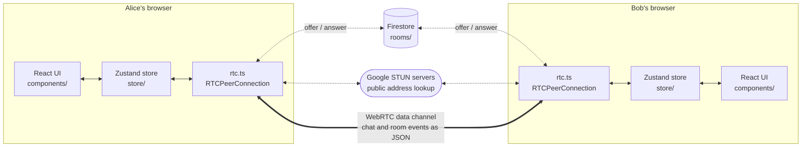
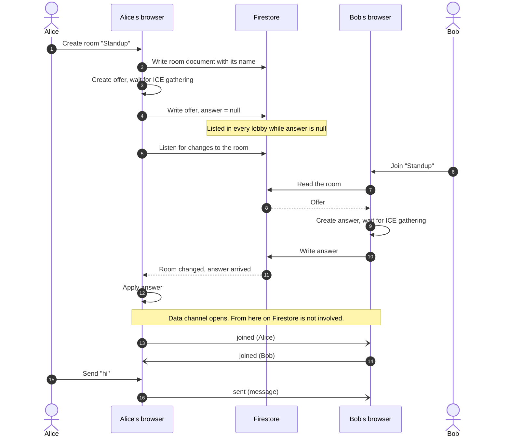
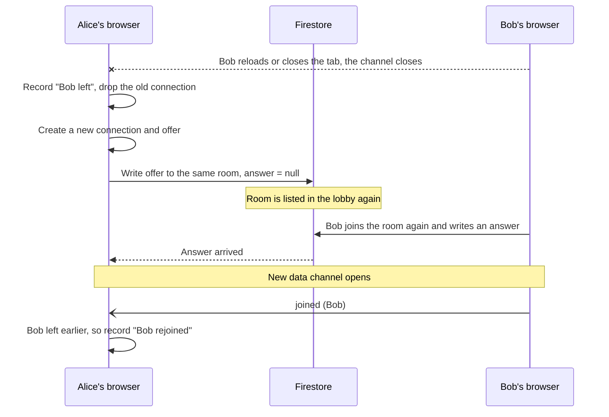

# Realtime Chat

Peer-to-peer chat built with React, TypeScript and WebRTC data channels.

## Getting started

```bash
cd client
npm install
npm run dev
```

Open http://localhost:5173 in two tabs or on two devices. Enter a name, create a room in one, and join it from the other.

## Architecture

I chose **peer-to-peer (option B)**: messages travel directly between the two browsers over a WebRTC data channel.



Solid lines carry chat traffic; dotted lines are only used while connecting.

### Why peer-to-peer

- **No server in the message path.** Chat messages, edits and deletes go straight from one browser to the other, so no server sees, stores or has to relay them.
- **Nothing to run for the chat itself.** There's no WebSocket server to host, scale or keep alive. The only backend is the small amount of signaling below.
- **It's the brief's preferred option,** and it shows the parts of real-time communication that a relay hides: offers and answers, ICE, connection state, and what happens when a peer disappears.

### Why Firestore for signaling

Two browsers need a shared place to swap a WebRTC offer and answer before they can talk directly. I used Firestore for that instead of writing a signaling server:

- **Realtime out of the box.** `onSnapshot` tells the room's creator the moment an answer arrives, which is all a signaling channel needs.
- **No backend code to write or deploy.** The client talks to Firestore directly, so the project is a single front-end app.
- **The signaling data doubles as the room list.** Each room is one document in `rooms/` holding its name, the offer and the answer. The lobby lists rooms whose answer is still empty, meaning they're waiting for someone to join.

### Connecting a room



Both sides wait for ICE gathering to finish before writing, so each offer and answer already contains every network candidate. That keeps signaling to two writes per connection, with no separate candidate exchange.

### Leaving and rejoining



Alice never has to reload. Whoever stays in the room re-opens it for the next person.

## Project structure

```
client/src/
  App.tsx              page frame: lobby or room
  components/
    Header.tsx         title and leave button
    Lobby.tsx          name, room list, create room
    ChatRoom.tsx       tabs, participants, messages, composer
    MessageList.tsx    messages and join/leave rows
    MessageItem.tsx    one message, with editing for your own
    MessageForm.tsx    message input
    ParticipantList.tsx  people in the room
    Avatar.tsx         initials and active indicator
  store/
    index.ts           store, connects rtc events to it
    roomSlice.ts       name, room, peer, join, create
    chatSlice.ts       events, send, edit, remove
  types/
    events.ts          ChatEvent, RoomEvent
    message.ts         Message
    room.ts            Room
  utils/
    formatTime.ts      "5 minutes ago" and 09:21 times
    linkify.tsx        turns URLs in a message into links
    participants.ts    who has been in the room, and who is active
  libs/
    firebase.ts        Firestore setup
    rtc.ts             peer connection, data channel, signaling
  test/                unit tests (Vitest)
client/test/           end-to-end tests (Playwright)
```

## Message protocol

Peers exchange events as JSON strings over one WebRTC data channel, one event per `send()`. The channel uses WebRTC's default settings, so events arrive reliably and in order. The types live in [`client/src/types/events.ts`](client/src/types/events.ts).

### Event types

| Type | Kind | Sent over the channel? | Meaning |
|---|---|---|---|
| `sent` | chat | yes | A new message. |
| `edited` | chat | yes | An existing message's text changed. See below. |
| `deleted` | chat | yes | An existing message was removed. See below. |
| `joined` | room | yes | Sent by each side when the data channel opens. |
| `left` | room | no | Added locally when the data channel closes. |
| `rejoined` | room | no | Added locally instead of `joined` when that person has left before. |

The receiver ignores any other type, and any `left` or `rejoined` that arrives over the channel, and logs a warning.

### Chat events

```json
{
  "type": "sent",
  "sessionId": "<room id>",
  "payload": {
    "message": {
      "id": "6f1c…",
      "userId": "a93e…",
      "userName": "Alice",
      "text": "Hello",
      "createdAt": 1763078400000,
      "editedAt": 1763078460000
    },
    "metadata": {}
  }
}
```

- `sessionId` is the room the event belongs to.
- `message.id` is a random UUID created by the sender. It identifies the message for both people.
- `message.userId` is a random UUID per browser tab, so two people with the same name stay distinct.
- `message.createdAt` is the sender's clock, in milliseconds since 1970.
- `message.editedAt` is only present once a message has been edited, and `message.deletedAt` once it has been deleted.
- `metadata` is a generic slot (`ChatEvent<T>`) for extra data per event. It is empty today.

### Room events

Sent when the channel opens:

```json
{ "type": "joined", "userName": "Bob" }
```

Each side stores room events with a local `createdAt`, so they show a time in the chat like messages do.

### Edits and deletes

Both reuse the chat event shape and point at the original message by `payload.message.id`.

- **`edited`:** carries the whole message with the new `text` and an `editedAt` time; `createdAt` keeps the original time. The receiver replaces the message with that `id`, and both people see "(edited)" next to it.
- **`deleted`:** carries the message with `text` emptied and a `deletedAt` time. The receiver keeps the entry and shows "Message deleted" in its place, so both people can see that something was removed. A deleted message can't be edited again.
- **Ownership:** a receiver ignores an edit or delete whose `payload.message.userId` does not match the original message's `userId`, so people can only change their own messages.
