# Realtime Chat

A chat room where messages go straight from browser to browser. No server relays, stores or can read them.

We built it with React, TypeScript and WebRTC data channels. A small FastAPI server introduces the browsers to each other and carries no messages.

<p align="center">
  
  
  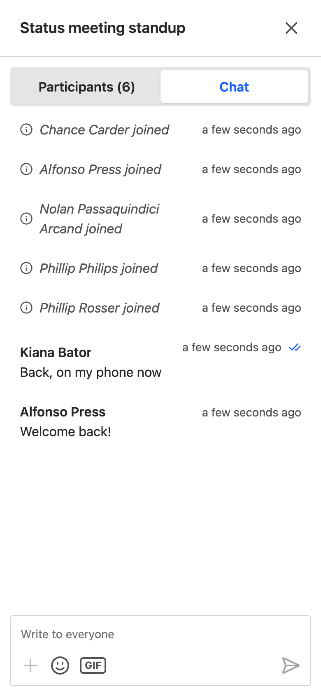
</p>

Each section answers the same questions: what we did, why we did it, why we didn't do more, and what the issue is. We measured each performance number on this code, with the scripts in [`client/test/load-test/`](client/test/load-test).

## Contents

1. [At a glance](#at-a-glance)
2. [Run it](#run-it)
3. [Core architecture](#core-architecture)
4. [Firebase](#firebase)
5. [Why Firebase is no longer the default](#why-firebase-is-no-longer-the-default)
6. [Signaling service](#signaling-service)
7. [How real-time messaging works](#how-real-time-messaging-works)
8. [Multi-participant](#multi-participant)
9. [Core features](#core-features)
10. [Edge cases](#edge-cases)
11. [Additional features](#additional-features)
12. [Message protocol](#message-protocol)
13. [Testing strategy](#testing-strategy)
14. [Known issues and next steps](#known-issues-and-next-steps)
15. [Project structure](#project-structure)

## At a glance

**Core features**

| #   | Feature                                     | Status                                                                   | Read more                                                       |
| --- | ------------------------------------------- | ------------------------------------------------------------------------ | --------------------------------------------------------------- |
| 1   | Real-time messaging, no refresh             | Built. A message reaches another screen in a median of 6 ms, one machine | [How real-time messaging works](#how-real-time-messaging-works) |
| 2   | Many people in one room                     | Built as a mesh. Tested with seven, the number in the design mockup      | [Multi-participant](#multi-participant)                         |
| 3   | Presence: who is in the session             | Built                                                                    | [Presence](#presence)                                           |
| 4   | Edit your own messages, the others see it   | Built                                                                    | [Editing and deleting](#editing-and-deleting)                   |
| 5   | Delete your own messages, the others see it | Built                                                                    | [Editing and deleting](#editing-and-deleting)                   |
| 6   | A styled UI that follows the design mockup  | Built, with five differences on purpose                                  | [The UI](#the-ui)                                               |

**Technical constraints**

| Constraint                                        | How the project meets it                                                       |
| ------------------------------------------------- | ------------------------------------------------------------------------------ |
| TypeScript and React                              | React 19, TypeScript 6, Vite, Tailwind, Zustand                                |
| A server in any language                          | Python: FastAPI on Uvicorn                                                     |
| Small, meaningful commits                         | See `git log --oneline`                                                        |
| Documented build and run steps                    | [Run it](#run-it)                                                              |
| Documented architecture, with the reasons         | [Core architecture](#core-architecture)                                        |
| Documented message protocol                       | [Message protocol](#message-protocol)                                          |
| Documented trade-offs, known issues, improvements | In each section, and collected in [Known issues](#known-issues-and-next-steps) |

**Quality and testing**

| Goal                                          | Status                                                                            |
| --------------------------------------------- | --------------------------------------------------------------------------------- |
| Automated tests for the core message logic    | 120 tests: 67 unit, 19 server, 34 end to end                                      |
| Separation of concerns, testable architecture | [Core architecture](#core-architecture) and [Testing strategy](#testing-strategy) |
| A described testing strategy                  | [Testing strategy](#testing-strategy)                                             |

**Edge cases**

| Question                                  | Short answer                                                                                        | Read more                                                         |
| ----------------------------------------- | --------------------------------------------------------------------------------------------------- | ----------------------------------------------------------------- |
| A participant disconnects and reconnects? | The others see "left" in about 6 ms and keep chatting, then see "rejoined"                          | [Disconnecting and reconnecting](#disconnecting-and-reconnecting) |
| Does a new participant see history?       | No. A returning participant sees what their own browser saved                                       | [History](#history)                                               |
| A large volume of messages?               | A room with 10,000 messages opens in 0.08 s and holds 60 frames per second, with a virtualized list | [A large volume of messages](#a-large-volume-of-messages)         |

**Additional features**

| Area          | Feature                                    | Status                                                  |
| ------------- | ------------------------------------------ | ------------------------------------------------------- |
| Media         | Image and file sharing with preview        | Partly: image and GIF links show inline. No file upload |
| Real-time     | Typing indicators, read receipts           | Built                                                   |
| Performance   | Virtualized list for 10k+ messages         | Built. Measured before and after, up to 20,000 messages |
| Security      | End-to-end encryption                      | Built, with an unverified key exchange and a size limit |
| DevOps        | Dockerfile and docker-compose, one command | Built: `make up`                                        |
| Accessibility | Keyboard navigation, screen readers        | Partly                                                  |
| Testing       | End-to-end tests                           | Built: 34 Playwright tests in real Chrome               |
| API design    | REST endpoint for history with pagination  | Not built, on purpose                                   |
| Rich content  | Link previews, emoji picker, Giphy         | Built                                                   |
| Theming       | Alternative themes, design system          | Not built                                               |
| AI            | Smart features                             | Not built                                               |

## Run it

### One command, with Docker

```bash
make up               # builds and starts signal-svc on :8080 and the app on :3000
make logs             # follows both
make down             # stops and removes them
```

Open http://localhost:3000 in two or more browser windows. Enter a name in each, create a room in one, and join it from the others.

GIF search needs a [Giphy API key](https://developers.giphy.com). Put `VITE_GIPHY_API_KEY=<key>` in `client/.env.local` and `make up` passes it to the build. Without a key the GIF button is disabled, and the rest of the app works.

### Local development

You need Node 24, Python 3.12 and [uv](https://docs.astral.sh/uv/).

```bash
make install          # signal-svc's .venv and the git pre-commit hook, then the client's node_modules

cd signal-svc
make dev              # FastAPI signaling server on :8080

cd client
npm run dev           # app on :5173
```

`/` uses the FastAPI signaling server. `/old` uses the earlier Firebase signaling and needs no local server.

### Tests, linting and measurements

```bash
make test             # everything: signal-svc's tests, the client's unit tests and the e2e suite

cd client
npm test              # 67 unit tests (Vitest)
npm run test:e2e      # 34 end-to-end tests (Playwright, real Chrome); starts both servers itself
npm run lint          # tsc, ESLint and Prettier
npm run load-test     # re-measures everything charted in this README, and retakes the screenshots

cd signal-svc
make test             # 19 tests (pytest)
make coverage         # the same, with a coverage table
make lint             # ruff
```

`make load-test` re-runs the measurements into `docs/data/`, and `make plots` redraws the charts from them with Python and matplotlib.

Each commit runs both projects' lint through [pre-commit](.pre-commit-config.yaml). [CI](.github/workflows/ci.yml) runs lint, the three test suites, the client build and a Docker build on each pull request and push to `main`, and prints a coverage table for both projects.

## Core architecture

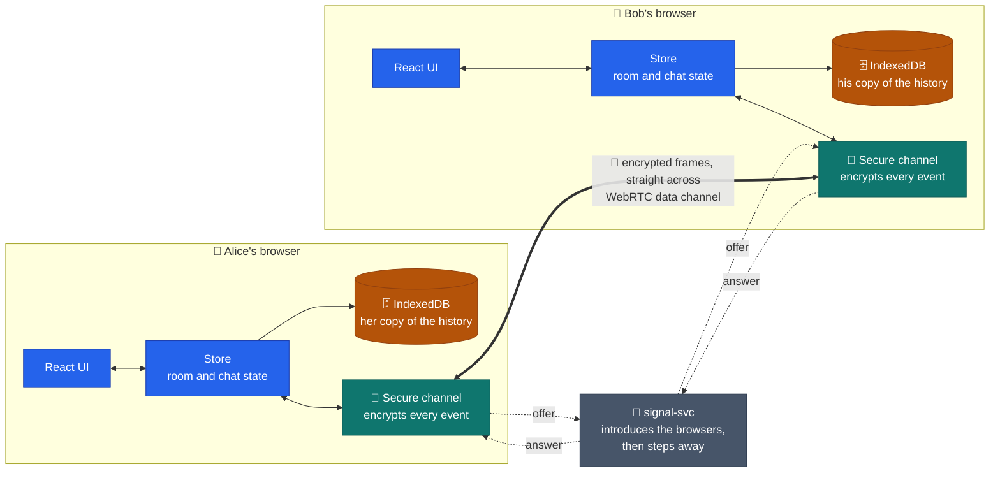

- **What we did:** browsers talk to each other over WebRTC data channels. Each pair of people in a room has its own encrypted connection. The thick line is the path a message takes. The dotted lines carry the introduction and nothing after it.
- **Why we did it:** the design leaves no message server to scale, no stored messages, and nothing for a server operator to read. End-to-end encryption fits, because the two ends of a connection already share a private channel.
- **Why we didn't** use a relay server: a relay sees each message unless you add stored ciphertext and key management, which is a second system. It would give bigger rooms and offline delivery, and we gave those up.
- **What the issue is:** the number of connections grows fast (seven people hold 21), nobody can leave a message for someone who is away, and each pair needs a network that lets them reach each other. See [Multi-participant](#multi-participant), [History](#history) and [When it fails](#when-it-fails).

### How the design got here

We did not draw this architecture up front. Each step fixed a problem that the step before it exposed.

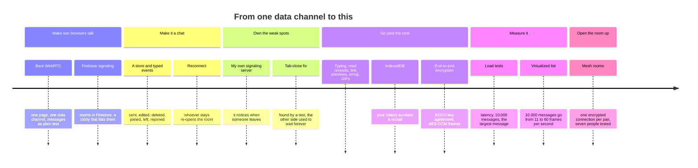

Four decisions shaped the rest:

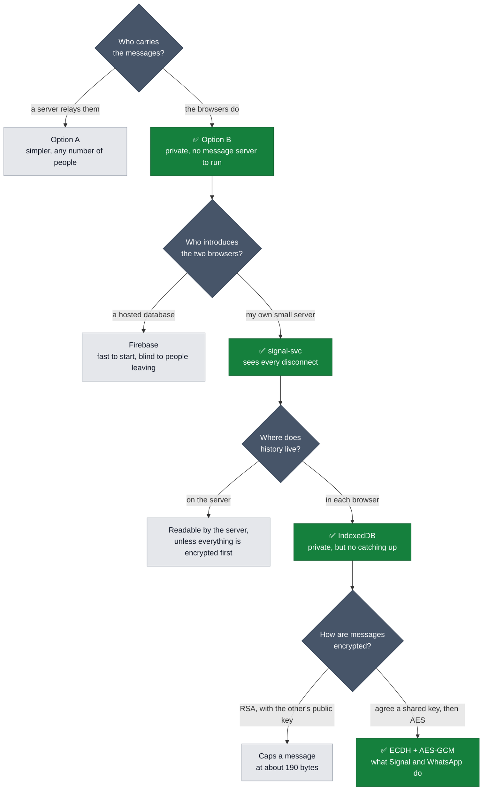

### Separation of concerns

The client has four layers. Each one talks to the layer below it and knows nothing further down.

| Layer                                                                | Knows about                                                                         | Does not know about         |
| -------------------------------------------------------------------- | ----------------------------------------------------------------------------------- | --------------------------- |
| Components (`components/`)                                           | What to draw, what the user did                                                     | WebRTC, encryption, storage |
| Store (`store/`)                                                     | Chat rules: who may edit what, what "rejoined" means, when a message counts as sent | How bytes travel            |
| Transport (`libs/rtc.ts`, `libs/secureChannel.ts`, `libs/crypto.ts`) | Peer connections, key exchange, encrypted frames, reconnecting                      | What a message means        |
| Signaling (`libs/signaling/`)                                        | How to swap an offer and an answer                                                  | The other three layers      |

The store's 42 tests run in plain Node against a fake transport. The signaling layer is one small interface with two implementations, so `/old` runs on Firebase without an `if` anywhere else in the app.

## Firebase

- **What we did:** the first working version used Firestore, a hosted database, as the meeting point. It still runs on `/old`. A room is one document. Browsers write offers and answers into it, each addressed to one person, and watch it for the ones addressed to them.
- **Why we did it:** it got two machines talking with no server to write. Firestore pushes each change to every browser, so the live lobby cost almost nothing.

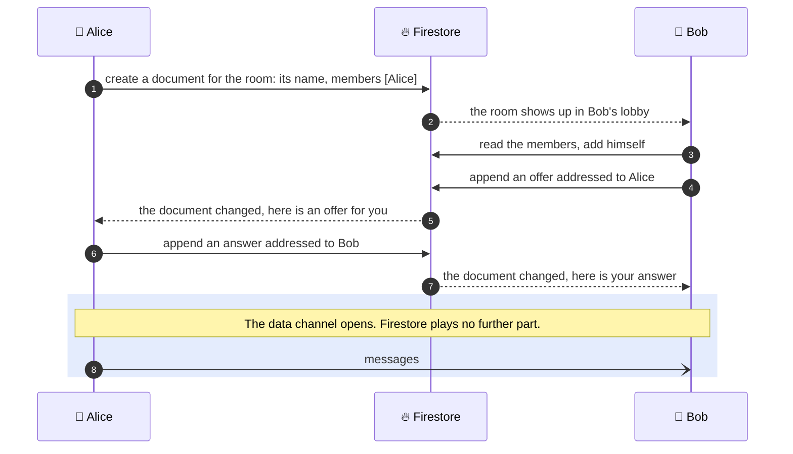

### Trade-offs with Firebase

| What Firebase gives                                              | What it costs                                                                                                                      |
| ---------------------------------------------------------------- | ---------------------------------------------------------------------------------------------------------------------------------- |
| No server to write, run or deploy                                | The project depends on our Firebase account staying alive. Nobody else can run the whole system on their own machine                |
| A live lobby for free: Firestore pushes changes to every browser | Firestore knows what a browser has written. It cannot tell that a browser has gone away                                            |
| Works across machines out of the box                             | Each offer and answer, which include network addresses, sits at a third party until someone deletes it                             |
| Zero configuration to start                                      | The project's configuration is in the client bundle, and what is allowed depends on rules set in a console, outside the repository |

- **What the issue is:** Firestore knows what a browser wrote and cannot tell that a browser has gone. Someone who closes their laptop stays on the member list, and the room stays in the lobby with nobody in it.

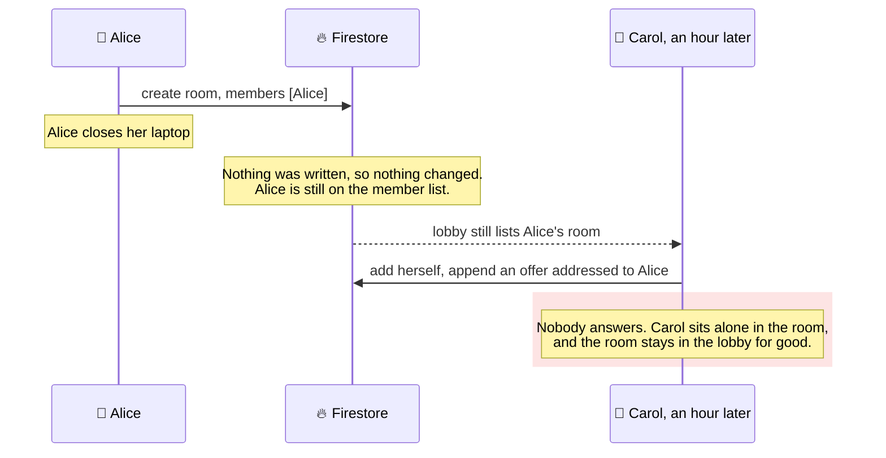

Nothing cleans those documents up, so the `/old` lobby lists every room anyone has created.

## Why Firebase is no longer the default

- **Why we didn't** stay with it: a signaling service has to know who is still there, and that takes a live connection to each browser. A WebSocket is one; a database write is not. Working around it in Firestore means heartbeats, timestamps and a scheduled cleanup job, which adds up to a worse server written in a harder place.
- **Why we did** write our own: the whole system now runs on one machine. `make up` starts all of it with no account, no keys and no network beyond STUN.
- **Why we didn't** delete `/old`: it shows the signaling layer is swappable. The store, the encryption and the UI are identical on both pages.

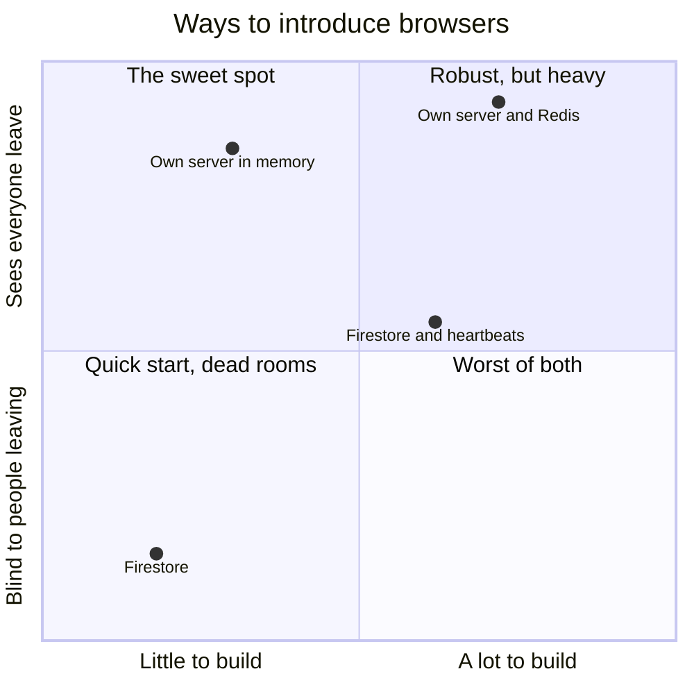

## Signaling service

- **What we did:** `signal-svc` is a FastAPI application with one WebSocket endpoint. Each browser opens one WebSocket to it as the page loads and keeps it open. The service does three jobs:
  1. It keeps the lobby. The list of rooms lives in memory, and each time it changes the service pushes it to every connected browser.
  2. It tells a newcomer who is already in the room, then passes offers and answers between two named people.
  3. It notices departures. A closed WebSocket removes that browser from its room, and the service deletes a room once nobody is left in it.
- **Why we did it:** see [Why Firebase is no longer the default](#why-firebase-is-no-longer-the-default).
- **What it never sees:** a chat message or an encryption key.

### Connecting a room

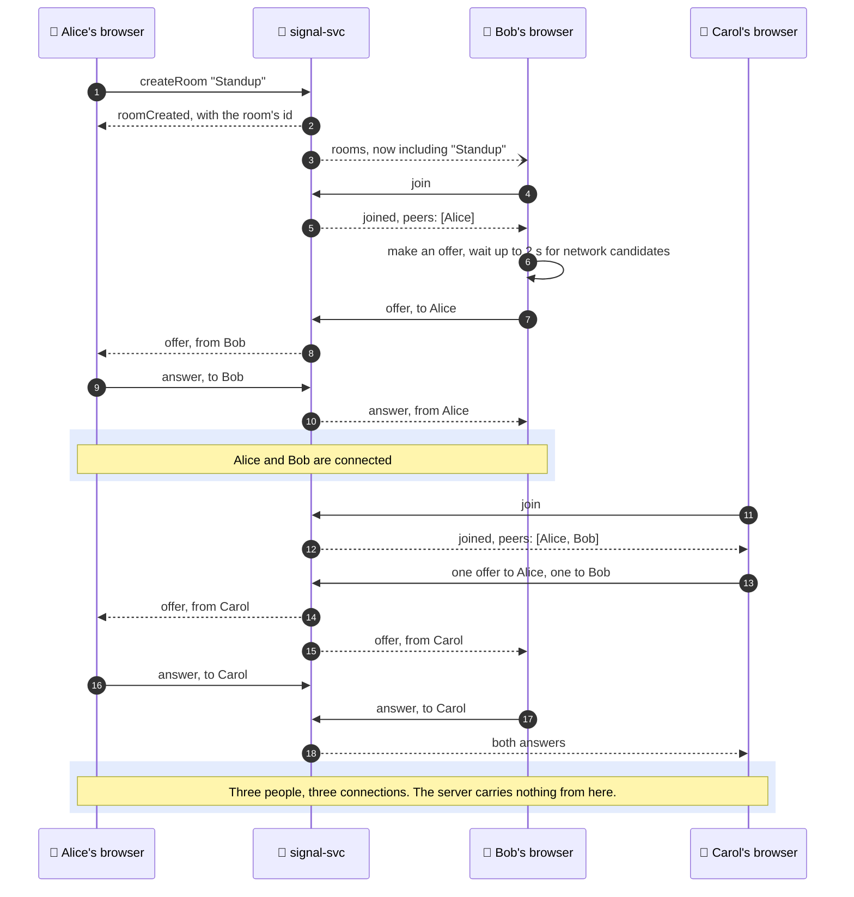

The newcomer makes the offers and the people already there answer, so two browsers never call each other at once.

### Room states

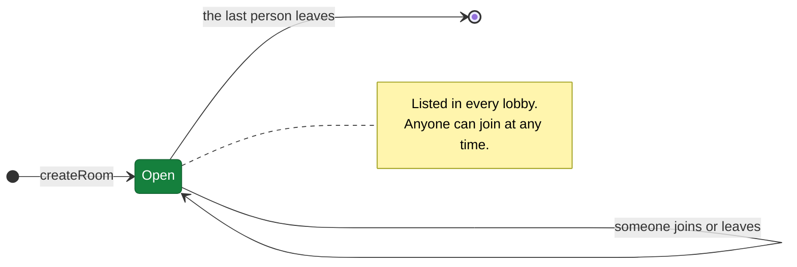

The room logic is a plain class. It takes "this connection sent this" and returns "send these messages to these connections". It never touches a socket, so we test it without a server.

### Signaling protocol

JSON messages over one WebSocket at `ws://localhost:8080/api/v1/signaling/ws`. A Pydantic model validates each incoming message before it reaches the room logic.

| Direction        | Type          | Fields                    | Meaning                                                                       |
| ---------------- | ------------- | ------------------------- | ----------------------------------------------------------------------------- |
| client to server | `createRoom`  | `name`                    | Create a room and enter it.                                                   |
| client to server | `join`        | `roomId`                  | Enter a room.                                                                 |
| client to server | `offer`       | `roomId`, `peerId`, `sdp` | An offer for one person in the room.                                          |
| client to server | `answer`      | `roomId`, `peerId`, `sdp` | An answer for the person who made the offer.                                  |
| server to client | `rooms`       | `rooms`                   | Every room with someone in it. Sent on connect and whenever the list changes. |
| server to client | `roomCreated` | `room`                    | Reply to `createRoom`.                                                        |
| server to client | `joined`      | `roomId`, `peers`         | Reply to `join`: the ids of the people already there.                         |
| server to client | `offer`       | `roomId`, `peerId`, `sdp` | An offer, with the id of the person who sent it.                              |
| server to client | `answer`      | `roomId`, `peerId`, `sdp` | An answer, with the id of the person who sent it.                             |
| server to client | `error`       | `message`                 | One of the refusals below.                                                    |

| Refusal                        | Cause                                                          |
| ------------------------------ | -------------------------------------------------------------- |
| `Invalid message`              | Not JSON, an unknown type, or a missing field                  |
| `Room not found`               | The room id does not exist, or the room was deleted            |
| `You are already in this room` | A second `join` from the same connection                       |
| `You are not in this room`     | An offer or answer from a connection outside the room          |
| `That person has left`         | An offer or answer addressed to someone who is no longer there |

The service also has two HTTP endpoints: `GET /api/v1/previews?url=` for [link previews](#rich-content-link-previews-emoji-picker-giphy), and `GET /health`.

### Current trade-offs of the signaling service

These choices keep the service at about 400 lines of Python.

| What we did                                         | Why we did it                                                                         | What the issue is                                                                                                                             |
| --------------------------------------------------- | ------------------------------------------------------------------------------------- | --------------------------------------------------------------------------------------------------------------------------------------------- |
| Rooms live in memory                                | No database to run. A room means something only while a browser is connected          | A restart forgets every room. The service must run as one process: a second worker would have its own list of rooms                           |
| No accounts, no authentication                      | A name typed in the lobby is enough                                                   | Anyone who can reach the server can create rooms, join any room, or flood it. There is no rate limit                                          |
| No limit on room size                               | Small groups are the use case                                                         | Nothing stops a room of 50, which would need 1,225 connections                                                                                |
| Offer and answer in one piece each (no trickle ICE) | Two messages per connection in place of a stream of candidates                        | Each side waits for its network candidates before sending, capped at 2 seconds. A candidate found later is never sent                         |
| The lobby is public                                 | Anyone should be able to see and join a room                                          | Each connected browser receives every room's name and id. There are no private or invite-only rooms                                           |
| The client never reconnects its WebSocket           | It kept the client small                                                              | If the service restarts, open chats carry on, but the service has forgotten the room, so nobody new can join it until the people in it reload |
| STUN only, no TURN relay                            | A TURN server relays traffic, which costs money and puts a server in the message path | Two people behind strict corporate firewalls or some mobile networks cannot connect at all. See [When it fails](#when-it-fails)               |
| Plain `ws://` and `http://`                         | It runs on localhost                                                                  | Deployed, it needs TLS in front. Browsers refuse `ws://` from an `https://` page                                                              |
| The preview endpoint fetches any http(s) URL        | Link previews need a server, because browsers block cross-site page reads             | A deployed server could be asked to fetch internal addresses (an SSRF risk). It needs an allow-list or a private-address block first          |

## How real-time messaging works

### The short version

Connected browsers share open pipes, one per pair, and nothing else. Press Enter and your browser encrypts the message once for each person in the room and pushes it into each pipe. The other browsers are already listening on their ends, so the message arrives without anyone asking for it. There is no polling, no "check for new messages" and no server to wake up.

A pipe is a WebRTC data channel in its default mode. That mode gives the two guarantees the chat relies on: every frame arrives, and frames on one pipe arrive in the order they were sent.

### One message, start to finish

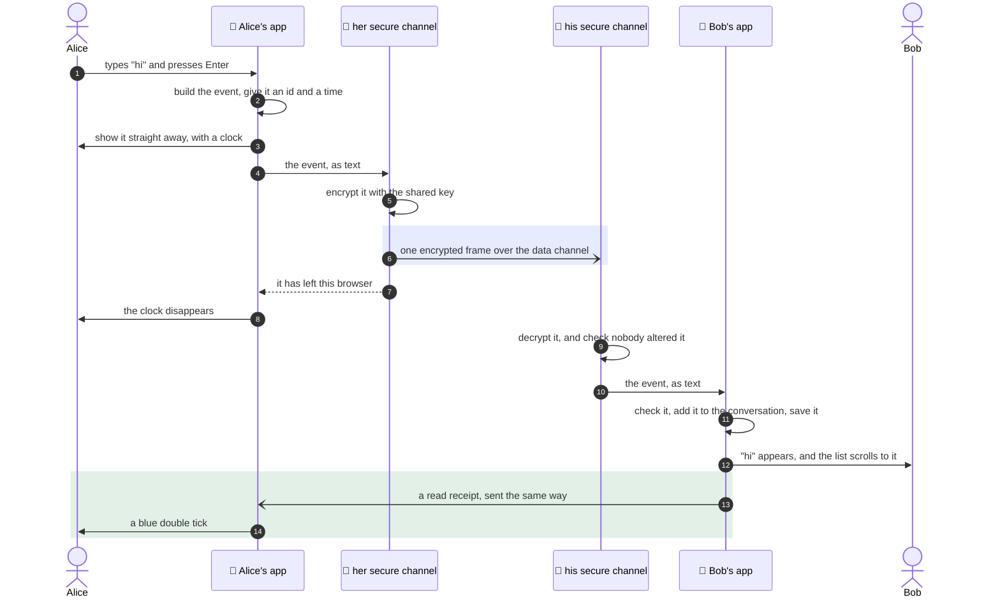

The diagram shows one pair. In a room of five, Alice's browser encrypts and sends four times, once per person, each time with that pair's own key.

- Your own message shows before it is sent (step 3), so the screen never waits for the network. The clock stays until the encrypted frames have left your browser.
- The receiver checks before it trusts (step 11). It applies an edit or delete if it comes from the person who wrote the original message, and ignores a frame it does not recognise.
- Each browser saves its own copy. With no shared database, a browser's IndexedDB is the one record it will have.

Edits, deletes, typing notices and read receipts take the same path as events of other types.

### The states of one connection

Your browser holds one of these for each other person in the room.

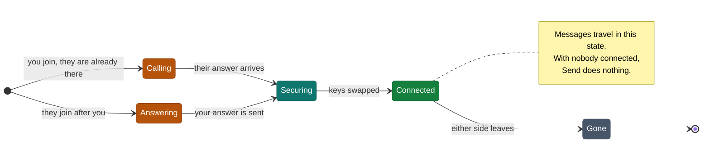

If someone leaves, the others drop that one connection and keep the rest. Whoever joins next calls everyone who is there.

### How fast it is

We measured this in two Chrome windows on one machine, so the figures are the cost of the app itself (encrypting, the WebRTC stack, decrypting, drawing) with no internet in between. A real network adds its own delay, and up to two seconds per connection for finding network routes.

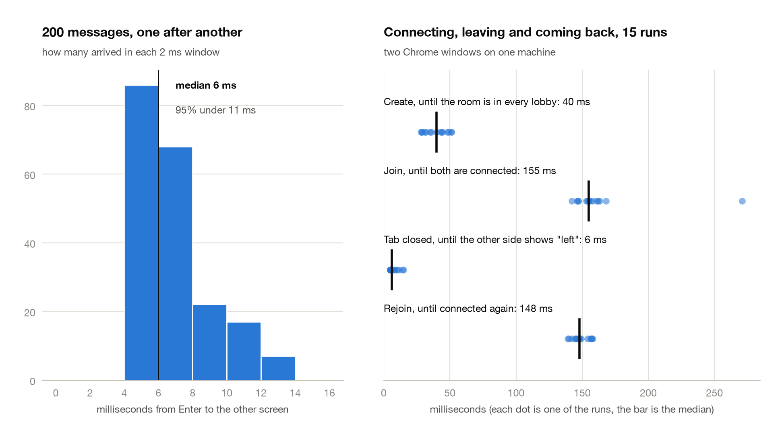

- A message is on the other screen a median of 6 ms after Enter. 95% arrive within 11 ms, and the slowest of 200 took 13 ms.
- Close a tab and the other side shows "left" in about 6 ms.
- Joining takes about 155 ms from the click to being connected, and rejoining 148 ms.
- **What the issue is:** joining took 35 ms when a room held two people, because the first person had an offer waiting. A newcomer now builds its offers at the moment it joins.

### When it fails

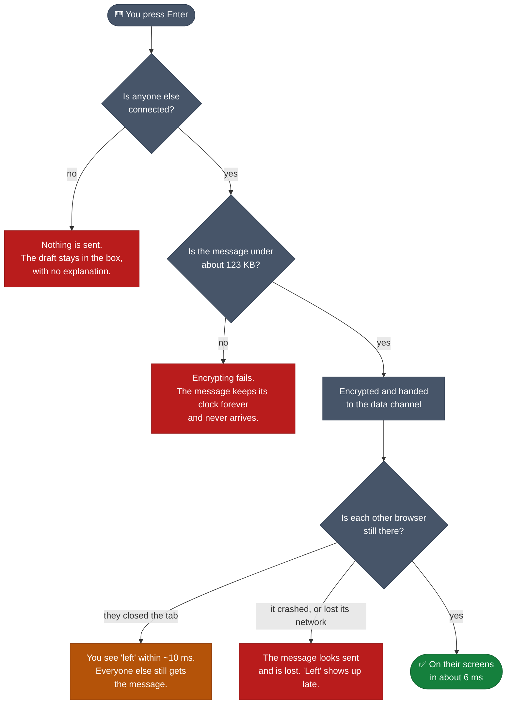

| Failure                                            | What you see                                                                            | Cause                                                                                                                                          | What would fix it                                                                        |
| -------------------------------------------------- | --------------------------------------------------------------------------------------- | ---------------------------------------------------------------------------------------------------------------------------------------------- | ---------------------------------------------------------------------------------------- |
| Nobody else is in the room                         | Send does nothing. The draft stays                                                      | There is no pipe to push into, and no server to hold the message                                                                               | Disable Send and say "waiting for someone to join", or queue messages until someone does |
| The message is too large                           | A clock that never goes away. Nobody gets the message                                   | See [the size limit](#security-end-to-end-encryption)                                                                                          | Split large messages into chunks, and show "failed" with a retry in place of the clock   |
| Someone closes their tab                           | "Bob left", almost at once. The rest of the room carries on                             | Their browser closes its connections on its way out                                                                                            | Nothing. The app is built to do this                                                     |
| Someone's browser crashes or drops off the network | Your messages look sent. "Left" appears late: not within 60 seconds when we measured it | A crashed browser cannot say goodbye, and the app reacts to a closed channel and nothing else. A cleared clock means "left my browser"         | Watch the connection's health as well as the channel, and add a delivery acknowledgement |
| Two people cannot reach each other directly        | Those two never see each other's names or messages. Everyone else sees both             | Each pair needs its own direct route, and nothing forwards a message between two people who lack one                                           | A TURN relay, at the cost of a server in the message path                                |
| The signaling service is down                      | An empty lobby. Create and Join do nothing visible                                      | Open chats keep working, but nobody can start or join one                                                                                      | Reconnect the WebSocket, and show that the service is unreachable                        |
| Two people send at the same instant                | The two messages can be in a different order on different screens                       | Each browser shows messages in the order they arrive, and arrival order differs per pair. After a reload a browser sorts by the sender's clock | A shared counter per room in place of arrival order and wall-clock time                  |

## Multi-participant

- **What we did:** a room holds any number of people as a mesh. A newcomer asks the service who is there and opens one encrypted connection to each person. A message goes out once per connection. We tested rooms of three and of seven, the number in the design mockup.
- **Why we did it:** the design shows seven people in a room, and a mesh gets there with no message server and with the encryption unchanged.

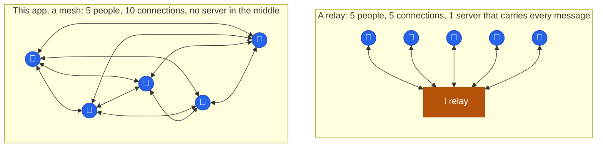

| People in the room          | 2   | 3   | 5   | 7 (the mockup) | 12  |
| --------------------------- | --- | --- | --- | -------------- | --- |
| Connections in a mesh       | 1   | 3   | 10  | 21             | 66  |
| Connections through a relay | 2   | 3   | 5   | 7              | 12  |

- **Why we didn't** use a relay server:

|                               | Mesh (built)                                 | Relay server                                      |
| ----------------------------- | -------------------------------------------- | ------------------------------------------------- |
| Room size                     | Small groups. Seven tested                   | Hundreds                                          |
| Server sees messages          | Never                                        | Ciphertext, if end-to-end encrypted               |
| Works when someone is offline | No                                           | Yes, the server can hold messages                 |
| Work to build                 | Addressed signaling, one connection per pair | A second server role, storage, and key management |

- **What the issue is:**

| Problem         | What we did                                                    | What the issue is                                                                                                    |
| --------------- | -------------------------------------------------------------- | -------------------------------------------------------------------------------------------------------------------- |
| Introductions   | The newcomer calls each person already in the room             | Joining a room of seven means six offers and six answers through the service                                         |
| Order           | Each browser shows messages as they arrive                     | Two people who send at the same instant can appear in a different order on different screens                         |
| Who is here     | Each browser lists the people it is connected to               | If Alice can reach Bob but not Carol, the three of them disagree about who is in the room                            |
| Encryption      | A key per pair                                                 | Your browser encrypts each message once per recipient: six times in a room of seven                                  |
| History         | Each browser keeps its own                                     | A newcomer starts empty, and two people's copies can differ                                                          |
| Room size       | No limit                                                       | Connections grow with the square of the room size. We tested seven and have not measured where it stops being usable |
| Seen and typing | "Seen" shows once one person has read; "typing" shows one name | You cannot tell who has read a message, and two people typing at once show as one                                    |

- **How we tested it:** `group.spec.ts` runs five tests in real Chrome windows. Three people all see each other's messages. A newcomer sees everyone who was already there. An edit and a delete reach everyone. One of three leaves and the other two keep chatting. Seven people all receive the same message. We also ran a three-person room by hand in Chrome.

## Core features

### Presence

<p align="center">
  
  
</p>

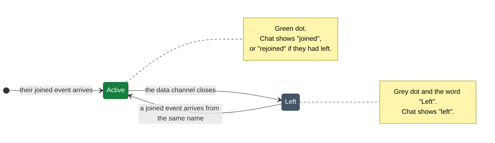

- **What we did:** each side sends one `joined` event with its name once a connection opens. Nobody sends "left": each browser writes it for itself the moment that connection closes. The Participants tab lists you and everyone who has been in the room, with a green dot for whoever is connected now.
- **Why we did it:** the connection already knows who is there, so presence needs no server and no heartbeat. Writing "left" locally also works if the other person has no chance to say goodbye.
- **What the issue is:** two people with the same name share one row, because the app tracks presence by name. The app notices a crash late ([When it fails](#when-it-fails)). Each browser lists the people it is connected to, so two people can disagree about who is here.
- **How we tested it:** `presence.spec.ts` (4 tests): both people show as active; a reload shows "left", then "rejoined"; if the creator leaves, the room stays open and a third person can join; the close button returns you to the lobby and tells the others.

### Editing and deleting

<p align="center">
  
</p>

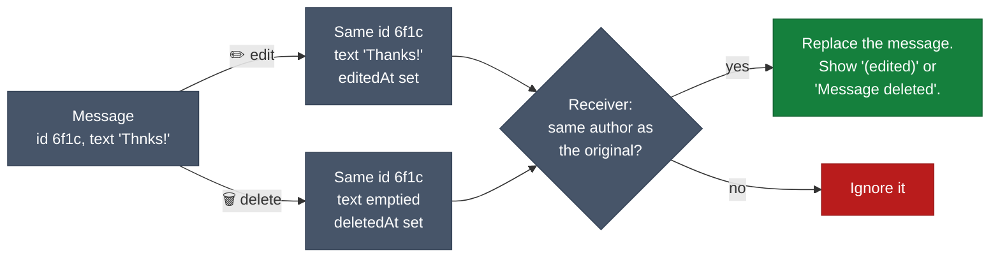

- **What we did:** an edit or a delete sends the whole message again, with the same id and one more field. A deleted message leaves "Message deleted" where it was, and its text is gone from every browser and every IndexedDB copy. A deleted message cannot be edited back.
- **Why we did it:** sending the whole message costs a few extra bytes, and the receiver never has to merge anything.
- **Why we didn't** trust the buttons alone: the edit and delete buttons appear on your own messages, but the receiver also refuses a change whose author does not match the original. The receiver's check protects the conversation.
- **What the issue is:** alone in the room, the app does not apply an edit or delete, because it could not send it. The others get the latest version and no edit history. Someone who is away never learns about the change.
- **How we tested it:** `edit-delete.spec.ts` (4 tests), one three-person test in `group.spec.ts`, and 10 store tests, including an edit that claims a different author and an edit to a deleted message.

### The UI

<p align="center">
  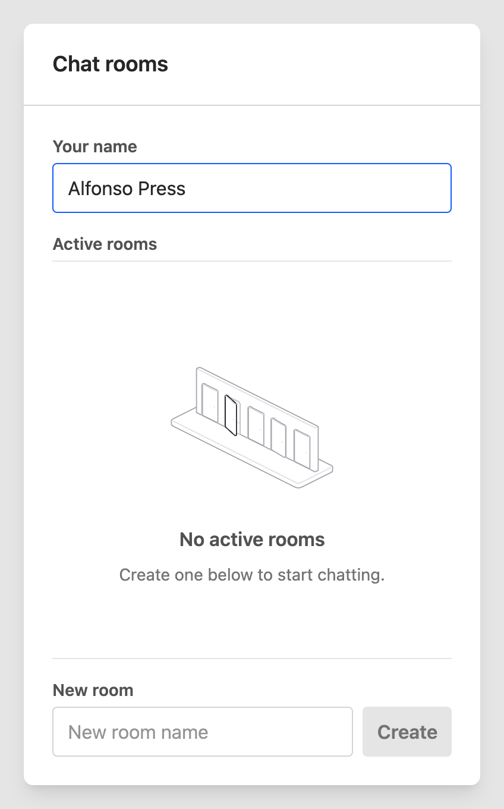
  
  
</p>

- **What we did:** the room follows the design mockup: the white card on a grey page, the title bar with a close button, the Participants / Chat switch with blue for the selected side, names in bold with the time on the right, italic join and leave rows with an info icon, underlined links, and the "Write to everyone" composer with its row of icons.
- **Why we didn't** copy it in five places:

| Mockup                      | Built                                                                    | Reason                                                                      |
| --------------------------- | ------------------------------------------------------------------------ | --------------------------------------------------------------------------- |
| Times as `09:21`            | "5 minutes ago", with `09:21` on hover                                   | Relative time reads faster in a live chat. The exact time is one hover away |
| Participants as plain names | Initials avatar, a green or grey dot, "(you)" by your own name           | A list of names does not show who is here right now                         |
| Two icons in the composer   | A third, GIF, and a Send that turns blue when there is something to send | GIF search needed a button. A grey Send that works looked broken            |
| No lobby                    | A lobby: your name, the open rooms, and a box to create one              | The mockup starts inside a room. Something has to come before it            |
| Empty areas are blank       | A small animated line drawing when a room or the lobby is empty          | An empty white box looked unfinished                                        |

- **What the issue is:** the mockup is narrow, and a narrow card on a phone wastes the screen. Below 640 px the room fills the screen, and the edit and delete buttons, which appear on hover with a mouse, stay visible on touch screens.
- **How we tested it:** `lobby.spec.ts` checks that the phone layout fills a 390 × 844 screen and that Create turns blue once the room has a name. `chat.spec.ts` checks that each message shows who sent it and when, that the list keeps the newest message in view, and that scrolling up shows a jump-to-newest button.

## Edge cases

### Disconnecting and reconnecting

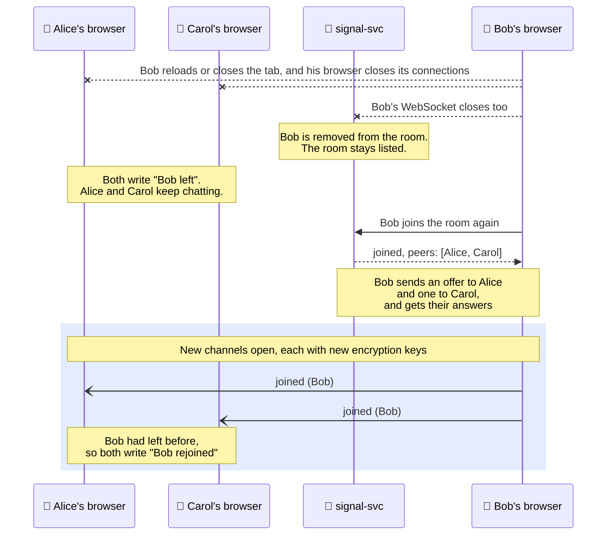

- **What we did:** a browser closes its connections as its page goes away. The others write "left", drop that one connection and carry on. Whoever comes back joins like a newcomer, gets their conversation back from their own browser's storage, and can still edit their own old messages.
- **Why we did it:** a test found that a closed tab did not close the data channel, because Chrome kills the page before it can say goodbye. The other person waited forever in a room that looked alive. One line that closes the connections on `pagehide` took "never" down to about 6 ms.
- **What the issue is:** a crash or a lost network gives the page no chance to say goodbye, so the others notice late. See [When it fails](#when-it-fails).
- **How we tested it:** three tests in `presence.spec.ts`, two in `history.spec.ts`, and "one of three leaves" in `group.spec.ts`.

### History

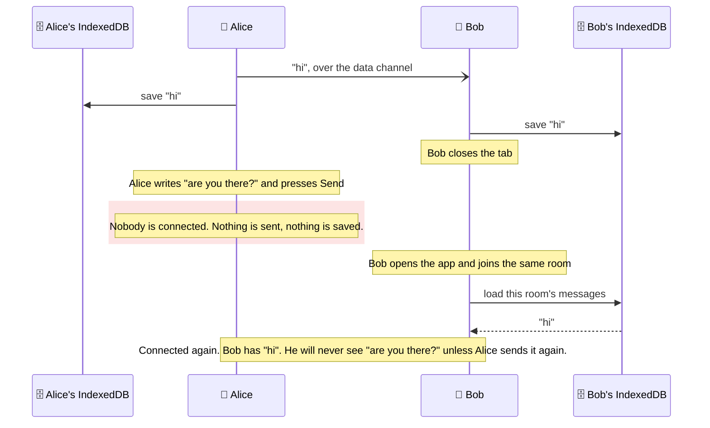

- **What we did:** each browser saves the messages it sends and receives in IndexedDB, and loads them when it joins that room again. A newcomer sees nothing from before they arrived.
- **Why we did it:** history on a server is history the server can read. Keeping it in each browser keeps it private at no extra cost.
- **Why we didn't** store it on the server: it would need each stored message encrypted with keys the server never has. The large messaging apps do that, and it is a second system to build.
- **What the issue is:** nobody can catch up on what they missed.

| Situation                                                 | What happens                                                                                                                              |
| --------------------------------------------------------- | ----------------------------------------------------------------------------------------------------------------------------------------- |
| You reload and rejoin                                     | Your history is back, with edits and deletes, and your own messages are still yours to edit                                               |
| Someone new joins                                         | They start with an empty chat                                                                                                             |
| The other person edits a message while you are away       | You keep the old version. Nothing is delivered later                                                                                      |
| Everyone leaves                                           | The server deletes the room. Each browser still holds the messages, but nobody can join that room again, so that history cannot be opened |
| You reload within a few milliseconds of an edit or delete | The save may not have finished, so your copy can miss that last change                                                                    |
| You clear your browser data, or use another device        | That history is gone. There is no other copy you can reach                                                                                |

- **What we would do next:** let whoever is already in the room hand their history to the person who joins, over the encrypted channel. It needs no server.
- **How we tested it:** `history.spec.ts` reads the browser's IndexedDB after a send, an edit and a delete, then reloads and checks that all three survived. Seven storage tests cover 200 messages saved at once in shuffled order, a reload, and copies that cannot be changed from outside.

### A large volume of messages

#### What the issue was

The recording shows a room with 10,000 saved messages on the first version of the message list. The pill in the title bar is a live frame counter that the test script adds; 60 is smooth. After the room opens, three messages arrive, then Bob types a line, sends it, scrolls up and jumps back down.

<p align="center">
  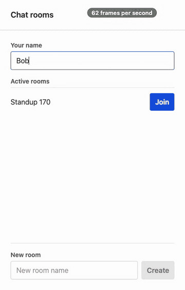
</p>

- The frame counter sits around 11 with nothing happening, and lower while Bob types.
- A message from Alice takes 1.6 seconds to show up.
- Typed letters appear in bursts, and scrolling stutters.
- At 20,000 messages the room drops to about one frame per second.

#### Why it happened

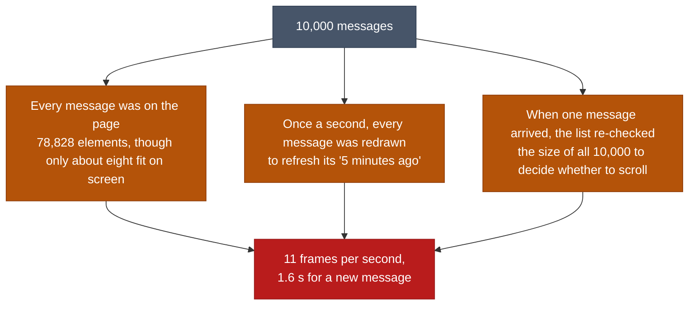

The page did work for 10,000 messages while a person can look at about eight.

#### What we did: only draw what is on screen

The list is now virtualized. The page contains the messages you can see, plus eight above and eight below so that scrolling never shows a gap.

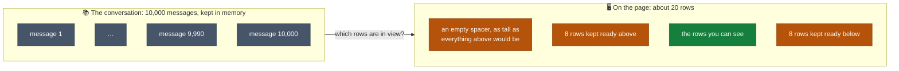

- The list gets the full height the whole conversation would take, so the scrollbar's size and position stay right.
- Rows have different heights (one word, a paragraph, a GIF, a link card). The list measures each row once it appears and estimates the rows nobody has scrolled to yet.
- At the bottom, new messages and rows that grow as an image loads keep you at the bottom. Scrolled up, you stay put and get the jump-to-newest button.
- The app caches link previews, because the list draws a row from scratch each time it scrolls back into view.
- **Why we didn't** write the windowing ourselves: [TanStack Virtual](https://tanstack.com/virtual) is a small library that works out which rows are in view. The rows are still this app's own components.

#### After

The same room, the same 10,000 messages and the same script:

<p align="center">
  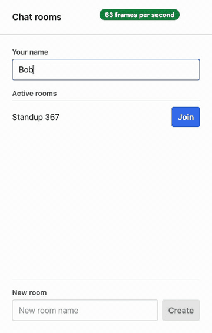
</p>

The frame counter stays at 60. The script finished in 14 seconds, against 39 for the first recording, because it waits for each message to appear before going on.


Each cell shows the first list, then the virtualized list.

|   Messages |       Room opens in | Frames per second, idle | Their message appears after |             Memory | Elements on the page |
| ---------: | ------------------: | ----------------------: | --------------------------: | -----------------: | -------------------: |
|        100 |     0.07 s / 0.10 s |                 60 / 60 |               24 ms / 13 ms |      42 MB / 40 MB |            937 / 181 |
|        500 |     0.17 s / 0.05 s |                 58 / 60 |               41 ms / 12 ms |      49 MB / 40 MB |          4,107 / 166 |
|      1,000 |     0.26 s / 0.05 s |                 57 / 60 |               69 ms / 12 ms |      54 MB / 41 MB |          7,877 / 170 |
|      2,500 |     0.52 s / 0.05 s |                 50 / 60 |              170 ms / 13 ms |      72 MB / 42 MB |         19,715 / 188 |
|      5,000 |     0.61 s / 0.07 s |                 38 / 60 |              796 ms / 13 ms |      96 MB / 44 MB |         39,731 / 188 |
| **10,000** | **1.20 s / 0.08 s** |             **11 / 60** |        **1,573 ms / 12 ms** | **140 MB / 49 MB** |     **78,828 / 166** |
|     20,000 |     2.22 s / 0.14 s |                1.4 / 60 |            4,802 ms / 13 ms |     242 MB / 58 MB |        157,209 / 177 |

At 10,000 messages the room opens in 0.08 s (it was 1.2 s), a new message appears in 12 ms (it was 1,573 ms), and the page holds 166 elements where it held 78,828.

#### How we tested it

A script generates the conversation with [faker](https://fakerjs.dev):

- six authors: Bob, whose screen is recorded, and five others with random names
- random messages: mostly one-line sentences, some quick replies ("Agreed.", "On it."), some long ones, and some that are a single emoji, so that rows have different heights
- random gaps of 2 to 58 seconds between messages
- a fixed seed, so the "before" and "after" runs use the same 10,000 messages

The script writes the history into the browser's IndexedDB, where the app keeps it, and then opens the room the normal way.

> Two browsers are connected in these runs, Bob's and Alice's. The other four names exist in the generated history and nowhere else.

Alice then sends messages; Bob receives them, types, sends, scrolls up and jumps back. The script takes its measurements inside Bob's page:

| Measurement                 | How the script takes it                                                                |
| --------------------------- | -------------------------------------------------------------------------------------- |
| Room opens in               | From clicking Join until the newest saved message is on screen                         |
| Frames per second, idle     | Frames drawn over five seconds with nobody doing anything                              |
| Their message appears after | From Alice pressing Enter until the message is in Bob's page, the middle value of five |
| Memory                      | The JavaScript heap, after asking the browser to collect garbage                       |
| Elements on the page        | A count of every element in the document                                               |

The same script measured each size from 100 to 20,000 on the old list and on the new one. A test in the normal suite, `large-volume.spec.ts`, now opens a room with 10,000 generated messages and checks that the newest one is on screen and that the room still sends and receives.

#### What the issue is now

- The browser's find in page (Ctrl+F) sees the drawn rows and nothing else. A long conversation would need its own search box.
- Screen readers see the drawn rows too, so they announce a list of about twenty items where the conversation has 10,000.
- Scroll far from an open edit box and you lose it, because the list removes that row and draws it again later.
- The scrollbar can shift a little the first time you scroll up through history, as measured heights replace estimates.
- The app still holds the whole conversation in memory and reads all of it from storage as the room opens. That works at 20,000 messages (58 MB, opens in 0.14 s). Far beyond that, the app would need to load history a page at a time.

## Additional features

### Media: image and file sharing with preview

- **What we did:** a message that is a link to an image and nothing else (`.gif`, `.jpg`, `.png`, `.webp`) shows as the image. GIFs work this way, and so does any image link you paste.
- **Why we didn't** build file upload: sending a file peer-to-peer means cutting it into pieces, because one data channel message cannot exceed 256 KB, then reassembling it on the other side with a progress bar. The "+" button from the mockup is there, disabled.
- **What the issue is:** the image loads from its host straight into each person's browser. That host learns their addresses, and a dead link means a dead picture.

### Real-time: typing indicators and read receipts

<p align="center">
  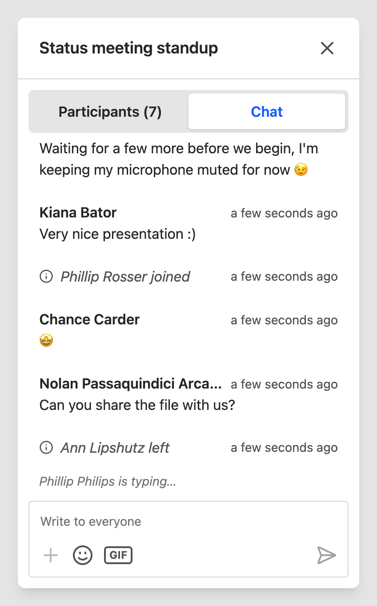
</p>

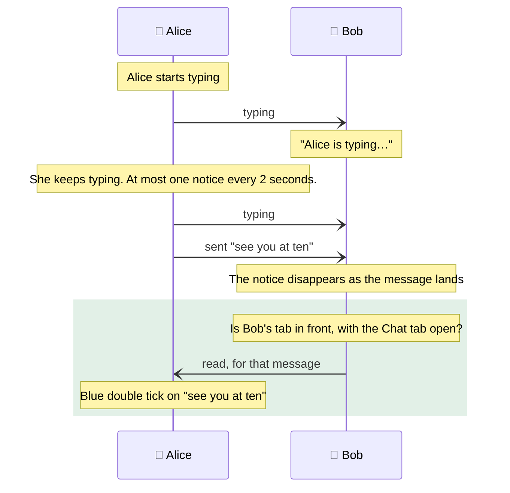

- **What we did:** both are ordinary events on the encrypted channels. Your browser sends "typing" at most once every 2 seconds, and the others show it for 3 seconds or until your message arrives. A read receipt goes out while the tab is visible and the Chat tab is open. Your own message has three states: a clock (not yet out of your browser), nothing (sent), and a blue double tick (seen).
- **Why we did it:** a receipt sent from a background tab would say "seen" for a message nobody looked at.
- **What the issue is:** in a group, "seen" means at least one person has read it, and the app does not say who. "Typing" shows one name at a time. "Seen" turns true once the chat is open, even if that message is scrolled out of view. The app does not save the tick, so a reload clears it.
- **How we tested it:** `typing-read.spec.ts` (3 tests) and 9 store tests, including the throttle, the 3-second timeout with a fake clock, and a slower reader who must not move "seen" backwards.

### Performance: a virtualized list for 10k+ messages

The list draws the rows on screen and a few around them. See [A large volume of messages](#a-large-volume-of-messages) for the recordings and the numbers.

### Security: end-to-end encryption

- **What we did:** the app encrypts each event that crosses a data channel with a key that exists in the two browsers at its ends and nowhere else. Each pair in a room has its own key.
- **Why we didn't** encrypt each message with the other person's public key: with RSA that caps a message at about 190 bytes, and a long sentence with a link can exceed it. We use the key pairs once, to agree on a shared key, and encrypt the messages with that, as Signal and WhatsApp do.

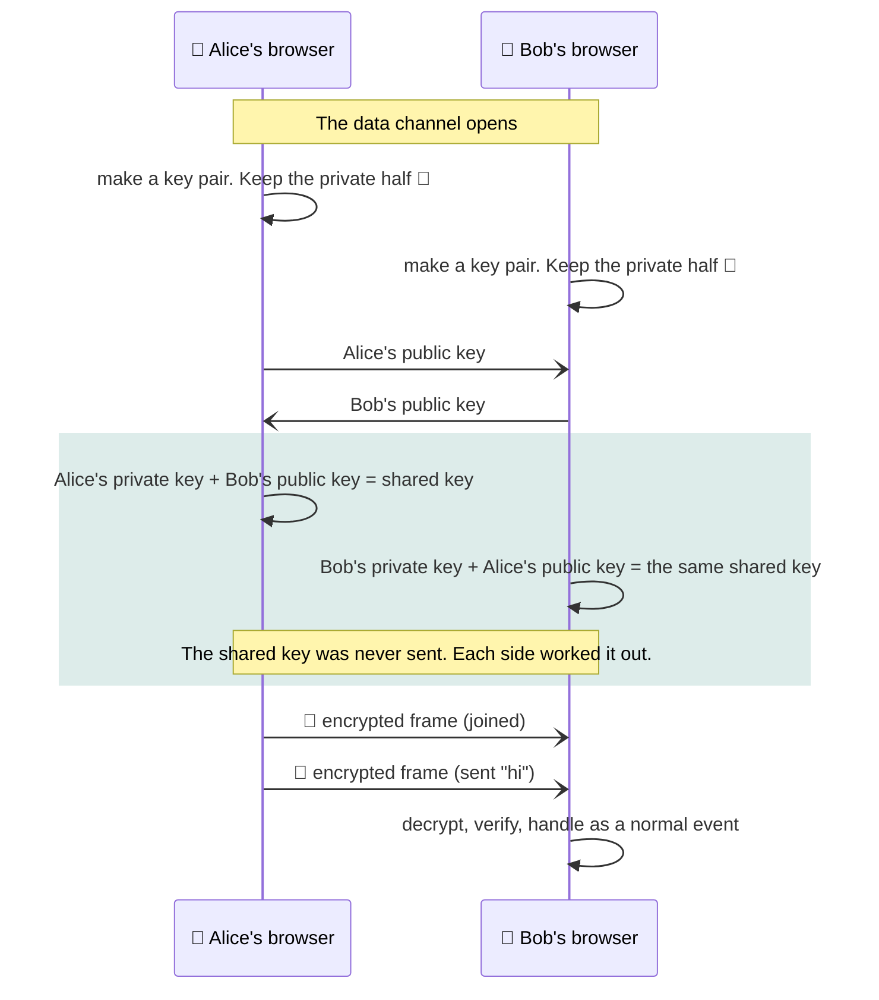

One message on its way out:

```mermaid
flowchart LR
  E["Event<br/>{type: sent, ...}"] --> T["As text<br/>(JSON)"]
  T --> C["AES-GCM<br/>shared key + a fresh<br/>random 12-byte nonce"]
  C --> X["Ciphertext<br/>+ a 16-byte seal"]
  X --> B64["Written as<br/>base64 text"]
  B64 --> F["Frame<br/>{type: encrypted, iv, data}"]
  F --> W(["💬 data channel"])

  classDef plain fill:#475569,stroke:#334155,color:#ffffff
  classDef secret fill:#0f766e,stroke:#115e59,color:#ffffff
  class E,T plain
  class C,X,B64,F,W secret
```

- Key agreement is ECDH on the P-256 curve, and encryption is AES-GCM with a 256-bit key. Both come from the browser's built-in Web Crypto, so the app has no cryptography library to trust or update.
- Each frame gets a fresh nonce, so the same text never produces the same bytes twice.
- AES-GCM seals each frame. Change one bit on the way and the receiver refuses it.
- Frames pass through a queue on the way out and on the way in, so they keep their order. Messages sent before the keys are ready wait.
- A key pair lives as long as one data channel, so no long-term private key exists to steal.

| Protected                                         | Not protected                                                                                               |
| ------------------------------------------------- | ----------------------------------------------------------------------------------------------------------- |
| Message text, edits, deletes                      | Room names, and when people connect: signal-svc sees those                                                  |
| Names, typing notices, read receipts              | Links you share: each browser asks signal-svc for a preview, so the server learns the URL                   |
| Everything, from the network between the browsers | GIF searches: the words go to Giphy                                                                         |
|                                                   | Messages saved in your own browser: IndexedDB holds them unencrypted, as most chat apps' local storage does |

- **What the issue is:** encryption puts a limit on message size.

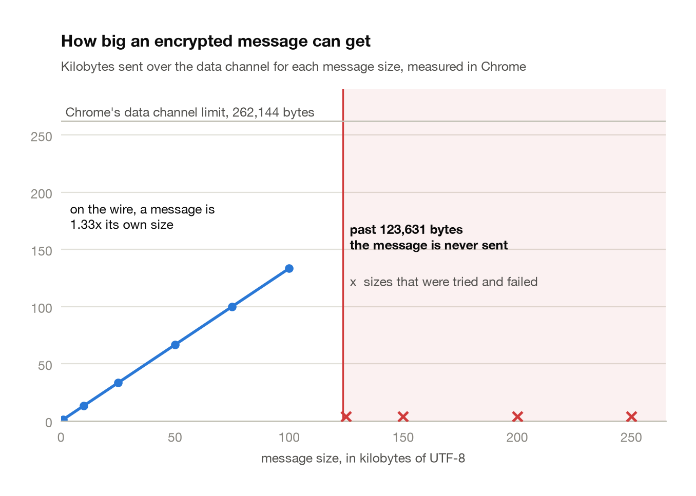

- A message goes out at about 1.33 times its own size, because the app writes the encrypted bytes as base64 text.
- Past 123,631 bytes the app never sends the message. That is about 123,000 plain letters, or 30,907 emoji at four bytes each. The step that writes the encrypted bytes as text hands them to the browser all at once, and beyond that size the browser runs out of stack.
- You see your message with a clock that never goes away. Nobody else gets it. Smaller messages sent afterwards still arrive.
- Fixing that step would move the limit to the next wall: Chrome refuses any single data channel message over 262,144 bytes, about 196 KB of text after the 1.33 times.
- Speed is fine: encrypting 100 KB took 1.4 ms and decrypting it 3.1 ms.

Two more issues:

- The app does not verify keys. Nothing proves the public key you received belongs to the other person, so a signaling server that wanted to could sit in the middle of the connection setup and swap in its own. Signal and WhatsApp let people compare a "safety number" to rule that out.
- The app saves a message that fails to send as if it had gone out, so after a reload it looks delivered.

- **How we tested it:** six cryptography tests (both sides read each other, the text never appears in a frame, a fresh nonce per frame, emoji survive, a stranger's key fails, a tampered frame is refused). Five secure-channel tests (keys are the one thing in the clear, 20 messages stay in order, early messages wait, both directions work, a broken channel reports "not sent"). Two tests in real Chrome: one records every frame both browsers send and checks that no message text or name appears in any of them, and one sends a 150,000-character message and checks that it keeps its clock and never arrives.

### DevOps: Dockerfile and docker-compose for one-command startup

- **What we did:** `make up` builds two images and starts them: the app (built with Node, served by nginx) on port 3000, and signal-svc on port 8080. The app waits until the service's health check passes. CI builds both images on each push.
- **What the issue is:** this is a local setup. It has no TLS, no domain and no production configuration, and the app's build fixes the service's address at `localhost:8080`.

### Accessibility: keyboard navigation and screen reader support

| Built                                                                                | Not built                                                                                         |
| ------------------------------------------------------------------------------------ | ------------------------------------------------------------------------------------------------- |
| Every icon-only button has a spoken name ("Send", "Edit message", "Leave room")      | New messages are not announced as they arrive                                                     |
| The Participants / Chat switch is marked up as tabs, with the selected one announced | The tabs do not move with the arrow keys, as full tabs should                                     |
| Form fields have visible labels                                                      | No test with a real screen reader                                                                 |
| Enter sends, Enter saves an edit, Escape cancels it                                  | The emoji picker is a third-party component, and its buttons are hard for assistive tools to find |
| Edit and delete appear on keyboard focus as well as on hover                         | No high-contrast or dark theme                                                                    |
| "Left" is written as a word as well as shown as a grey dot                           |                                                                                                   |
| Animations stay still for people who ask for reduced motion                          |                                                                                                   |

Lighthouse's accessibility audit scored 100 on both the lobby and a room during the UI pass. The audit cannot tell whether the app is pleasant to use with a screen reader, and we have not tested with one.

### Testing: end-to-end tests

34 Playwright tests drive real Chrome windows through each feature, with up to seven people in a room. See [Testing strategy](#testing-strategy).

### API design: REST endpoint for message history with pagination

- **Why we didn't** build it: a history endpoint needs a server that stores messages, and this server stores none so that a message can be read in the browsers and nowhere else. The two features pull in opposite directions, and we chose the encryption.
- **What we would build:** an endpoint that stores ciphertext, shaped like `GET /api/v1/rooms/{id}/messages?before=<cursor>&limit=50`. It would page backwards from the newest with a cursor, because new messages shift numbered pages.
- **What we did build:** one REST endpoint, for link previews, with typed responses and generated OpenAPI documentation at `/docs`.

### Rich content: link previews, emoji picker, Giphy

<p align="center">
  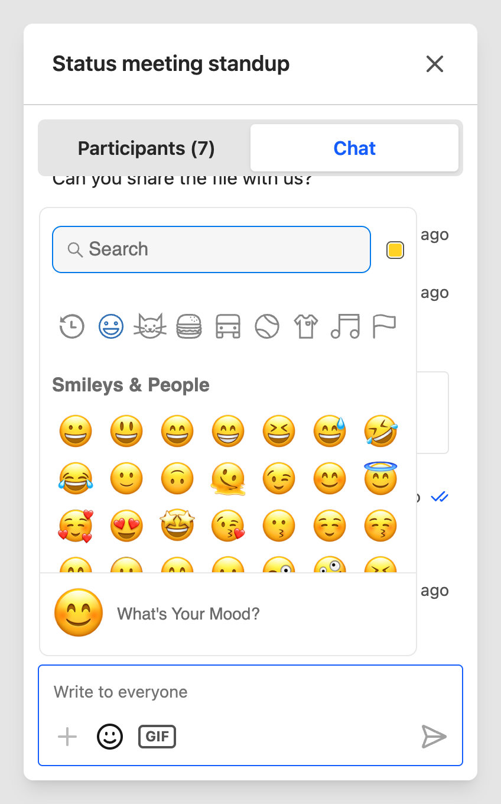
</p>

```mermaid
flowchart LR
  subgraph browser["🧑 Your browser"]
    L["A message with a link"]
    P["The preview card"]
  end
  L -->|"1. what is at this address?"| S["📡 signal-svc"]
  S -->|"2. fetch the page"| W["🌍 the website"]
  W -->|"3. its HTML"| S
  S -->|"4. title, description, image"| P

  classDef person fill:#2563eb,stroke:#1e40af,color:#ffffff
  classDef server fill:#b45309,stroke:#92400e,color:#ffffff
  classDef web fill:#475569,stroke:#334155,color:#ffffff
  class L,P person
  class S server
  class W web
```

- **What we did:** three things.
  - Link previews. A browser may not read another website's page, so the server fetches it, reads its title, description and image, and returns them. Each browser asks for itself, so everyone gets a card.
  - Emoji picker. The smiley button opens a searchable picker, and the emoji goes into your draft.
  - Giphy. The GIF button searches Giphy. Picking one sends its address as a message, and the image rule shows it.
- **What the issue is:** to preview a link your browser tells signal-svc the address, so previews cost some privacy. The server fetches any http(s) address it is given, which is unsafe to expose on the internet as it stands. Giphy needs a key, and the key ships in the app.
- **How we tested it:** `rich-content.spec.ts` picks an emoji and sends it; shares a link and sees the card, using the service's own documentation page so the test needs no outside website; and searches and sends a GIF with Giphy's replies faked. Five server tests cover reading a page's tags.

### Theming: alternative layouts or themes, design-system approach

- **Why we didn't** build it: the app has one light theme. Colours are Tailwind's built-in neutrals and one blue, written on each element, with no named design tokens and no dark mode. A design-system pass would start by naming those colours once (accent, text, muted, border) and using the names everywhere.

### AI: smart features

- **Why we didn't** build it: summarising or moderating needs the message text, and with end-to-end encryption no server has it. Such a feature would have to run inside the browser, or send text elsewhere as an explicit, visible choice.

## Message protocol

What two browsers send each other on one WebRTC data channel.

### Two layers

Two kinds of frame travel on the wire.

| Frame       | Fields                | Meaning                                                                  |
| ----------- | --------------------- | ------------------------------------------------------------------------ |
| `key`       | `publicKey` (JWK)     | This browser's public key. Sent once, when the channel opens. Not secret |
| `encrypted` | `iv`, `data` (base64) | One event, encrypted                                                     |

Each `encrypted` frame holds one event, as JSON.

### Event types

| Type       | Kind     | Sent? | Meaning                                                              |
| ---------- | -------- | ----- | -------------------------------------------------------------------- |
| `sent`     | chat     | yes   | A new message                                                        |
| `edited`   | chat     | yes   | A message's text changed                                             |
| `deleted`  | chat     | yes   | A message was removed                                                |
| `joined`   | room     | yes   | Sent by each side when their channel opens                           |
| `left`     | room     | no    | Written locally when a channel closes                                |
| `rejoined` | room     | no    | Written locally in place of `joined`, if that person had left before |
| `typing`   | presence | yes   | At most every 2 seconds while typing                                 |
| `read`     | presence | yes   | The newest message from someone else has been seen                   |

A receiver ignores any type it does not know. It also ignores a `left` or `rejoined` that arrives over a channel, because the app never sends those.

### Chat events

```json
{
  "type": "sent",
  "sessionId": "<room id>",
  "payload": {
    "message": {
      "id": "6f1c…",
      "userId": "a93e…",
      "userName": "Alice",
      "text": "Hello",
      "createdAt": 1763078400000
    },
    "metadata": {}
  }
}
```

- `sessionId` is the room the event belongs to.
- `message.id` is a random UUID made by the sender. Everyone uses it to identify the message.
- `message.userId` is a random UUID per browser tab, kept across reloads. The receiver checks ownership against it, so two people called "Alice" stay distinct.
- `message.createdAt` is the sender's clock, in milliseconds.
- `metadata` is an empty slot for per-event extras, typed so that later features can fill it without changing the shape.

### How edits and deletes are represented

Both reuse the chat event and point at the original by `payload.message.id`.

```json
{ "type": "edited",  "payload": { "message": { "id": "6f1c…", "text": "Hello!", "createdAt": 1763078400000, "editedAt": 1763078460000 } } }
{ "type": "deleted", "payload": { "message": { "id": "6f1c…", "text": "",       "createdAt": 1763078400000, "deletedAt": 1763078520000 } } }
```

(`sessionId`, `userId`, `userName` and `metadata` are left out here for width. The app sends them every time.)

- `edited` carries the whole message with the new `text` and an `editedAt`. `createdAt` does not change, so the message keeps its place.
- `deleted` carries the message with `text` emptied and a `deletedAt`. The receiver keeps the entry and shows "Message deleted".
- A receiver ignores an edit or delete whose `userId` differs from the original's.

### Room and presence events

```json
{ "type": "joined", "userName": "Bob" }
{ "type": "typing", "userName": "Bob" }
{ "type": "read", "messageId": "6f1c…" }
```

## Testing strategy

```mermaid
flowchart TD
  subgraph e2e["🌐 End to end: 34 tests, real Chrome windows"]
    direction LR
    E1["Does the whole thing work<br/>the way a person would use it?"]
  end
  subgraph unit["🧩 Client units: 67 tests, plain Node"]
    direction LR
    U1["Store: 42<br/>the chat rules"]
    U2["Storage: 7<br/>IndexedDB"]
    U3["Encryption: 11<br/>crypto and the secure channel"]
    U4["Helpers: 7<br/>time, links, participants"]
  end
  subgraph server["📡 Server: 19 tests, pytest"]
    direction LR
    S1["Room logic: 9<br/>no server needed"]
    S2["WebSocket: 5<br/>through the real app"]
    S3["Link previews: 5"]
  end
  e2e --> unit
  e2e --> server

  classDef top fill:#2563eb,stroke:#1e40af,color:#ffffff
  classDef mid fill:#0f766e,stroke:#115e59,color:#ffffff
  classDef low fill:#b45309,stroke:#92400e,color:#ffffff
  class E1 top
  class U1,U2,U3,U4 mid
  class S1,S2,S3 low
```

- **What we did:** 120 automated tests in three layers. We test rules where they are cheapest to test, and test the wiring once, for real.
  - The core message logic lives in the store, so most unit tests are there. They replace the network and the database with fakes, which makes awkward cases easy to stage: a message that could not be sent, an edit claiming someone else's name, a read receipt from a slower reader, a save that fails.
  - The encryption tests run between two fake ends of a pipe, so they can inspect what crossed it.
  - The server's room logic is a plain class, tested by calling it. The WebSocket tests then go through the real application.
  - The e2e tests fake nothing in the app: real Chrome windows, a real signaling server, real WebRTC connections, real IndexedDB.
- **Why we did it:** the e2e tests alone can catch a problem between the layers, and they have caught three (below). They are also the slowest, so the rules stay in the unit tests.

Coverage is 97% of lines in the client and 97% in the server. CI prints both tables on each run.

### What each feature is covered by

| Feature                         | End to end                 | Unit                                  |
| ------------------------------- | -------------------------- | ------------------------------------- |
| Sending and receiving           | `chat.spec.ts` (5)         | store                                 |
| Rooms of three and seven people | `group.spec.ts` (5)        | store, server room logic              |
| Lobby and rooms                 | `lobby.spec.ts` (4)        | server room logic and WebSocket tests |
| Presence, leaving, rejoining    | `presence.spec.ts` (4)     | store, helpers                        |
| Edit and delete                 | `edit-delete.spec.ts` (4)  | store                                 |
| Typing and read receipts        | `typing-read.spec.ts` (3)  | store                                 |
| History across reloads          | `history.spec.ts` (2)      | storage, store                        |
| Encryption                      | `encryption.spec.ts` (2)   | crypto, secure channel                |
| Links, emoji, GIFs              | `rich-content.spec.ts` (3) | helpers, server previews              |
| 10,000 messages                 | `large-volume.spec.ts` (1) |                                       |
| The Firebase page               | `old-firebase.spec.ts` (1) |                                       |

### What the tests found

1. Nobody noticed a closed tab. A new test closed someone's tab and waited for "left", which never came. Reloading had always worked, and that hid it. We fixed it, and "left" now shows in about 6 ms.
2. A reload straight after a delete brought the message back. The test reloaded a few milliseconds after deleting, before the save had finished. It is now a documented limit.
3. A three-person room failed to connect about one run in six. A connection that was created and used in the same instant sometimes gathered no network addresses at all, so its answer went out empty. The cause was a candidate pool setting left over from when the app created its one connection at page load. We removed it, and 40 of 40 repeat runs passed.
4. A message over 123 KB never sends, and the app says nothing. The load test that looks for the limit found it.

Measuring turned up a fifth problem: the first message list crawled at 10,000 messages, and that led to the virtualized list.

### Load test strategy

The tests above ask whether the app works. The load tests ask how well it works and where it stops. They live in [`client/test/load-test/`](client/test/load-test), with their own Playwright configuration and their own command.

```mermaid
flowchart LR
  S["🎬 A script<br/>plays Alice and Bob"] --> C["🪟🪟 Two real Chrome windows<br/>real server, real WebRTC,<br/>real IndexedDB"]
  C --> T["⏱️ A stopwatch inside the page<br/>stamps what a person would see"]
  T --> J["🗂️ docs/data<br/>the raw numbers, as JSON"]
  J --> P["🐍 docs/plots<br/>Python and matplotlib"]
  P --> R["📖 The charts and tables<br/>in this README"]

  classDef act fill:#2563eb,stroke:#1e40af,color:#ffffff
  classDef measure fill:#0f766e,stroke:#115e59,color:#ffffff
  classDef keep fill:#b45309,stroke:#92400e,color:#ffffff
  class S,C act
  class T measure
  class J,P,R keep
```

#### What we did

1. We measure what a person sees. The setup matches the end-to-end tests: real Chrome windows, the real signaling service, real WebRTC connections, real IndexedDB.
2. We keep the stopwatch inside the page. A timer in the test runner would also count the time the runner needs to talk to the browser. A watcher inside the page stamps the moment a message lands on it.
3. We change one thing at a time until something gives: the length of the conversation, the size of one message, or the number of repetitions.
4. We use the same input each run. The generated conversations use a fixed seed, so a "before" and an "after" compare the same 10,000 messages.
5. We run one script at a time, so two measurements never compete for the processor. Chrome starts with two extra switches: one for exact memory figures, and one that lets the script ask for a garbage collection before it reads memory.
6. We write numbers to files and draw charts from the files. Each result goes to [`docs/data/`](docs/data) and into git, and the scripts in [`docs/plots/`](docs/plots) draw the charts, so you can trace a figure in this README to a file and redraw it with `make plots`.
7. We keep the "before". If a measurement leads to a fix, the old numbers stay next to the new ones, and the same script produces both.

| Varies                 | Script                 | Range                                                                                                                                                                                               | Records                                                                                                                                                                    | Found                                                                                                                                                       |
| ---------------------- | ---------------------- | --------------------------------------------------------------------------------------------------------------------------------------------------------------------------------------------------- | -------------------------------------------------------------------------------------------------------------------------------------------------------------------------- | ----------------------------------------------------------------------------------------------------------------------------------------------------------- |
| Length of conversation | `large-volume.spec.ts` | 100, 500, 1,000, 2,500, 5,000, 10,000 and 20,000 saved messages                                                                                                                                     | Time to open, frames per second over five idle seconds, the worst single frame, memory, elements on the page, and the middle value of five messages received and five sent | The first list crawled at 10,000, which led to the [virtualized list](#a-large-volume-of-messages)                                                          |
| Size of one message    | `encryption.spec.ts`   | 13 sizes from 100 to 1,000,000 characters, the best of three each. Then a search for the largest message that goes through, for plain letters and for emoji. Then six sizes typed into the real app | Size of the encrypted frame, time to encrypt and decrypt, whether the message arrived, whether its clock is stuck                                                          | A message over 123,631 bytes [never sends](#security-end-to-end-encryption)                                                                                 |
| Number of repetitions  | `realtime.spec.ts`     | 200 messages one after another. Then 15 rounds of create, join, close the tab and join again, with a third window watching the lobby                                                                | The delay of each message, and four timings per round                                                                                                                      | A median of 6 ms per message, flat across the 200. On the first message list the same run climbed from 8 ms to 31 ms. See [How fast it is](#how-fast-it-is) |

Two more scripts produce pictures. `recording.spec.ts` records the two GIFs with their live frame counter, and `screenshots.spec.ts` fills a room with the seven people from the design mockup and retakes each screenshot in this README.

#### Why we didn't put them in CI

The load tests measure; they do not pass or fail. Timings on a shared CI machine change from run to run, and a limit loose enough to survive that would catch nothing. A finding becomes an ordinary test, and that test does run in CI:

| The load test found                      | The test that guards it                                                                                                                          |
| ---------------------------------------- | ------------------------------------------------------------------------------------------------------------------------------------------------ |
| A room with 10,000 messages was unusable | `large-volume.spec.ts`: a room with 10,000 generated messages opens on its newest message, and still sends and receives                          |
| A message that is too large never sends  | `encryption.spec.ts`: a 150,000-character message keeps its clock and never arrives, which records the limit as behaviour until someone fixes it |

#### What the issue is

- No network. Everything runs on one machine, so the figures are the app's own cost.
- Two people. The latency and large-room runs connect two browsers. We have not measured how delay grows with the number of people in a room.
- No load on the signaling service. No script opens hundreds of rooms or connections at once.
- No long sessions. No script runs for hours, so we would not see slow memory growth.
- One run each. We measured each room size once per version, on one machine. The exact figures will differ on another computer.

### What is not tested

- Real networks. Everything runs on one machine, so firewalls, mobile networks and packet loss are untested.
- Other browsers. The tests run in Chrome; Firefox and Safari are untested.
- Screen readers.
- Rooms larger than seven.

## Known issues and next steps

| #   | Issue                                                                                                                                           | Explained in                                                               |
| --- | ----------------------------------------------------------------------------------------------------------------------------------------------- | -------------------------------------------------------------------------- |
| 1   | Message order can differ between people when two send at the same instant. After a reload, order follows the senders' clocks                    | [When it fails](#when-it-fails)                                            |
| 2   | A newcomer sees no history, and nothing is delivered to someone who is away                                                                     | [History](#history)                                                        |
| 3   | Two people who cannot reach each other directly do not see each other, while the rest of the room sees both                                     | [When it fails](#when-it-fails)                                            |
| 4   | The app notices a crashed or disconnected peer late, and messages sent meanwhile look sent but are lost                                         | [When it fails](#when-it-fails)                                            |
| 5   | The app does not verify encryption keys, so a hostile signaling server could intercept                                                          | [Security](#security-end-to-end-encryption)                                |
| 6   | A message over about 123 KB never sends, and shows a clock forever                                                                              | [Security](#security-end-to-end-encryption)                                |
| 7   | The app does not show errors: a send with nobody there, a failed join, an unreachable server                                                    | [When it fails](#when-it-fails)                                            |
| 8   | No relay server, so some networks cannot connect at all                                                                                         | [Signaling service](#current-trade-offs-of-the-signaling-service)          |
| 9   | The signaling service has no authentication, rate limit or room size limit, keeps rooms in memory, and its preview endpoint fetches any address | [Signaling service](#current-trade-offs-of-the-signaling-service)          |
| 10  | Link previews tell the server which links are shared                                                                                            | [Rich content](#rich-content-link-previews-emoji-picker-giphy)             |
| 11  | Two people with the same name share one row in Participants. A duplicated browser tab shares its user id with the original                      | [Presence](#presence)                                                      |
| 12  | "Seen" means at least one person has read the message, and "typing" shows one name at a time                                                    | [Typing and read receipts](#real-time-typing-indicators-and-read-receipts) |
| 13  | Tested in Chrome, on one machine, with at most seven people in a room                                                                           | [Testing strategy](#testing-strategy)                                      |

With more time we would work in this order:

1. Show errors. Disable Send when alone and say why; show a failed join; replace the endless clock with "failed, retry".
2. Hand history to whoever joins, over the encrypted channel.
3. Give everyone the same message order, with a counter per room in place of arrival order.
4. Notice a dead peer sooner, by watching the connection's health and adding delivery receipts.
5. Lift the message size limit: fix the base64 step, then split large messages into pieces. The same splitting gives file sharing.
6. Add a safety number, so two people can check nobody is in the middle.
7. Harden the service: a room size limit, reconnect from the client, limits on what the preview endpoint may fetch, rate limits, TLS and a relay server.

## Project structure

```
client/
  src/
    App.tsx              page frame: lobby or room
    components/
      Header.tsx         title and close button
      Lobby.tsx          name, room list, create room
      ChatRoom.tsx       tabs, participants, messages, composer, read receipts
      MessageList.tsx    the virtualized list: only on-screen rows, scrolling to the newest
      MessageItem.tsx    one message: editing your own, sending and seen marks
      MessageForm.tsx    composer, with the emoji and GIF pickers
      GifPicker.tsx      Giphy search
      LinkPreview.tsx    a card for the first link in a message
      ParticipantList.tsx  people in the room
      Avatar.tsx         initials and the active dot
    anims/
      Hairline.tsx       mounts an empty-state figure and plays it
      table.ts           the empty chat: a table with every seat empty
      corridor.ts        the empty lobby: a corridor of closed doors
      core/              the hairline drawing engine (MIT licence), unchanged
    store/
      index.ts           the store, and what to do with each incoming event
      roomSlice.ts       name, room, who is connected, join (with saved history), create
      chatSlice.ts       events, send, edit, remove, typing, read receipts, saving
    types/
      events.ts          ChatEvent, RoomEvent, TypingEvent, ReadEvent
      frames.ts          what crosses the data channel: KeyFrame, EncryptedFrame
      message.ts         Message
      room.ts            Room
      signaling.ts       the interface both signaling backends implement
    utils/
      formatTime.ts      "5 minutes ago" and 09:21
      linkify.tsx        links, the first link, image-only messages
      participants.ts    who has been in the room, and who is active
    libs/
      rtc.ts             one peer connection and data channel per person in the room
      secureChannel.ts   key exchange, then every event encrypted, in order
      crypto.ts          ECDH key pairs, AES-GCM encrypt and decrypt
      indexdb.ts         saved messages per room
      api.ts             HTTP client for signal-svc
      previews.ts        link previews, remembered per link
      giphy.ts           Giphy search
      firebase.ts        Firestore setup
      signaling/
        index.ts         picks a backend from the URL path
        server.ts        WebSocket client for signal-svc
        firebase.ts      Firestore signaling (/old)
    test/                unit tests (Vitest)
  test/                  end-to-end tests (Playwright), one file per feature
    load-test/           the measurements, recordings and screenshots in this README
  Dockerfile             builds the app, serves it with nginx

signal-svc/
  app/
    main.py              the FastAPI app, GET /health
    endpoints/v1/
      signaling/
        routers.py       the WebSocket
        handlers/        tracks connections, validates and delivers messages
        repositories/    the room logic
        schemas/         every message, as a Pydantic model
      previews/
        routers.py       GET /api/v1/previews
        handlers/        fetches a page and reads its tags
  tests/                 pytest
  Dockerfile

docs/
  data/                  what the load tests measured, as JSON
  plots/                 the Python scripts that draw the charts
  images/                the charts and screenshots

docker-compose.yml       both services, for make up
Makefile                 up, down, logs, install, test
.github/workflows/ci.yml lint, tests, coverage, builds
```
