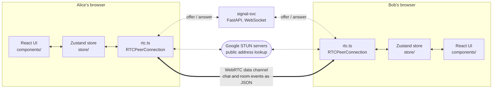
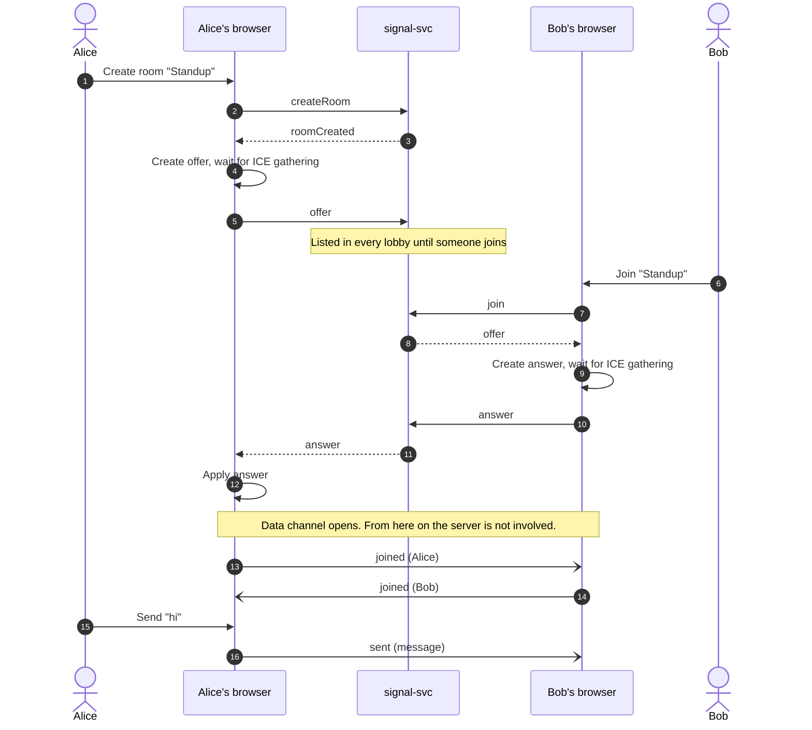
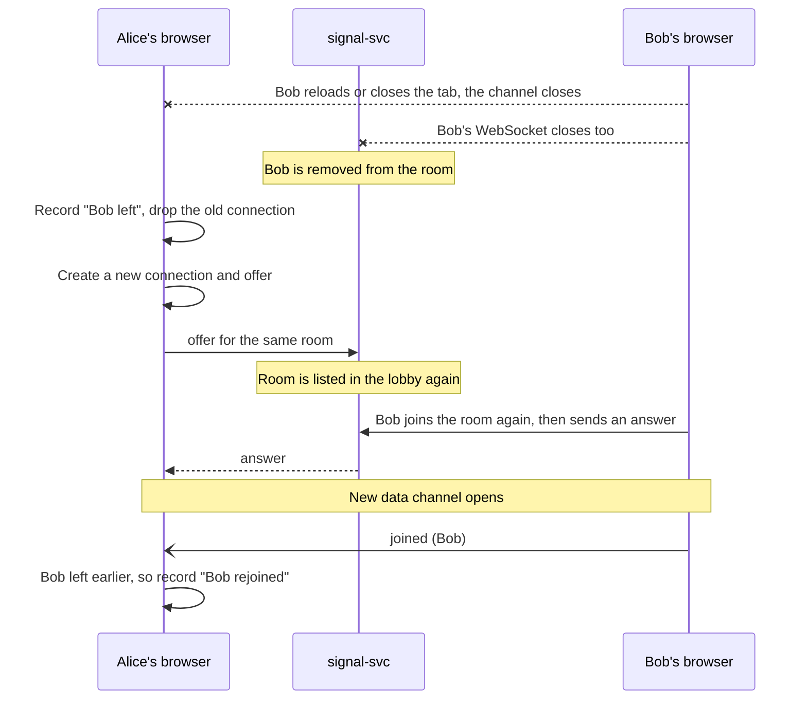

# Realtime Chat

Peer-to-peer chat built with React, TypeScript and WebRTC data channels.

## Getting started

You need Node 24, Python 3.12 and [uv](https://docs.astral.sh/uv/).

```bash
cd signal-svc
make install          # creates .venv and installs requirements/dev.txt
make dev              # FastAPI signaling server on :8080

cd client
npm install
npm run dev           # app on :5173
```

Or run the signaling server in Docker instead: `docker compose up --build signal-svc`.

Open http://localhost:5173 in two tabs or on two devices. Enter a name, create a room in one, and join it from the other.

- **`/`** uses the FastAPI signaling server (`signal-svc`).
- **`/old`** uses the earlier Firebase signaling and needs no local server.

Tests:

```bash
cd client
npm test              # unit tests (Vitest)
npm run test:e2e      # end-to-end tests (Playwright); starts signal-svc and the app itself

cd signal-svc
make test             # room logic unit tests, plus WebSocket tests through FastAPI's TestClient (pytest)
make lint             # ruff check and format
```

## Architecture

I chose **peer-to-peer (option B)**: messages travel directly between the two browsers over a WebRTC data channel.



Solid lines carry chat traffic; dotted lines are only used while connecting.

### Why peer-to-peer

- **No server in the message path.** Chat messages, edits and deletes go straight from one browser to the other, so no server sees, stores or has to relay them.
- **The server stays small.** It only helps two browsers find each other; once they're connected it carries no chat traffic at all.
- **It's the brief's preferred option,** and it shows the parts of real-time communication that a relay hides: offers and answers, ICE, connection state, and what happens when a peer disappears.

### Signaling: a FastAPI server, with Firebase kept on `/old`

Two browsers need a shared place to swap a WebRTC offer and answer before they can talk directly. The app has two ways to do that, behind one small interface (`Signaling` in [`client/src/types/signaling.ts`](client/src/types/signaling.ts)). [`libs/signaling/index.ts`](client/src/libs/signaling/index.ts) picks one from the URL path, and the rest of the app doesn't know which it is using.

**`/`: `signal-svc`, a FastAPI WebSocket server** on asyncio and Uvicorn.

- **It's what the brief expects:** a lightweight signaling server, about 300 lines of Python.
- **It knows when people leave.** When a browser's WebSocket closes, the server removes it from its room, and a room whose host leaves before anyone joins disappears from every lobby straight away. The Firebase version can't tell, so abandoned rooms stay listed.
- **Nothing hosted, no keys.** It runs locally with `make dev`, or in Docker with one `docker compose` command.
- **Every message is validated.** Pydantic models describe each message ([`schemas/`](signal-svc/app/endpoints/v1/signaling/schemas)). Anything that doesn't match gets an `error` back instead of reaching the room logic.
- **The room logic is plain code.** `RoomRepository` returns a list of messages to send instead of touching sockets, so it's unit tested without a server. `SignalingHandler` only parses and delivers.

**`/old`: Firestore, the first version.** Each room is a document in `rooms/` holding its name, the offer and the answer. `onSnapshot` tells the host when the answer arrives, and the lobby lists rooms whose answer is still empty. I kept it to show that the signaling layer can be swapped without touching the store or the UI.

### Connecting a room



Both sides wait for ICE gathering to finish before sending, for at most 2 seconds, so each offer and answer already contains the network candidates. Without that cap, one slow reply from a STUN server could hold the offer back forever. That keeps signaling to one offer and one answer per connection, with no separate candidate exchange. The `/old` page follows the same steps, with Firestore reads and writes in place of the WebSocket messages.

### Leaving and rejoining



Alice never has to reload. Whoever stays in the room re-opens it for the next person, and when the last person leaves, the server deletes the room.

### Signaling protocol (`/`)

JSON messages over one WebSocket to `ws://localhost:8080/api/v1/signaling/ws`. They are defined in [`requests.py`](signal-svc/app/endpoints/v1/signaling/schemas/requests.py) and [`responses.py`](signal-svc/app/endpoints/v1/signaling/schemas/responses.py).

| Direction | Type | Fields | Meaning |
|---|---|---|---|
| client → server | `createRoom` | `name` | Register a new room. |
| client → server | `offer` | `roomId`, `sdp` | Store an offer; the room is listed until someone joins. |
| client → server | `join` | `roomId` | Ask for a waiting room's offer. |
| client → server | `answer` | `roomId`, `sdp` | Answer the offer; relayed to the room's host. |
| server → client | `rooms` | `rooms` | The rooms waiting for someone. Sent on connect and whenever the list changes. |
| server → client | `roomCreated` | `room` | Reply to `createRoom`. |
| server → client | `offer` | `roomId`, `sdp` | Reply to `join`. |
| server → client | `answer` | `roomId`, `sdp` | The guest's answer, sent to the host. |
| server → client | `error` | `message` | For example "Room is not available" when a second guest tries to join. |

## Project structure

```
client/src/
  App.tsx              page frame: lobby or room
  components/
    Header.tsx         title and leave button
    Lobby.tsx          name, room list, create room
    ChatRoom.tsx       tabs, participants, messages, composer
    MessageList.tsx    messages and join/leave rows
    MessageItem.tsx    one message, with editing for your own
    MessageForm.tsx    message input
    ParticipantList.tsx  people in the room
    Avatar.tsx         initials and active indicator
  store/
    index.ts           store, connects rtc events to it
    roomSlice.ts       name, room, peer, join, create
    chatSlice.ts       events, send, edit, remove
  types/
    events.ts          ChatEvent, RoomEvent
    message.ts         Message
    room.ts            Room
    signaling.ts       Signaling interface both backends implement
  utils/
    formatTime.ts      "5 minutes ago" and 09:21 times
    linkify.tsx        turns URLs in a message into links
    participants.ts    who has been in the room, and who is active
  libs/
    rtc.ts             peer connection, data channel, reconnect
    firebase.ts        Firestore setup
    signaling/
      index.ts         picks a backend from the URL path
      server.ts        WebSocket client for signal-svc
      firebase.ts      Firestore signaling (/old)
  test/                unit tests (Vitest)
client/test/           end-to-end tests (Playwright), one file per area

signal-svc/app/
  main.py              FastAPI app, GET /health
  endpoints/
    base.py            /api router
    v1/
      base.py          /v1 router
      signaling/
        routers.py     WebSocket on /api/v1/signaling/ws
        handlers/
          signaling.py     tracks connections, validates and delivers messages
        repositories/
          rooms.py         room logic: create, offer, join, answer, disconnect
        schemas/
          requests.py      client → server messages
          responses.py     server → client messages
          common.py        RoomInfo, camelCase on the wire
signal-svc/tests/      pytest: room logic, and the WebSocket through TestClient
signal-svc/requirements/  prod.txt and dev.txt

docker-compose.yml     runs signal-svc
```

## Message protocol

Peers exchange events as JSON strings over one WebRTC data channel, one event per `send()`. The channel uses WebRTC's default settings, so events arrive reliably and in order. The types live in [`client/src/types/events.ts`](client/src/types/events.ts).

### Event types

| Type | Kind | Sent over the channel? | Meaning |
|---|---|---|---|
| `sent` | chat | yes | A new message. |
| `edited` | chat | yes | An existing message's text changed. See below. |
| `deleted` | chat | yes | An existing message was removed. See below. |
| `joined` | room | yes | Sent by each side when the data channel opens. |
| `left` | room | no | Added locally when the data channel closes. |
| `rejoined` | room | no | Added locally instead of `joined` when that person has left before. |

The receiver ignores any other type, and any `left` or `rejoined` that arrives over the channel, and logs a warning.

### Chat events

```json
{
  "type": "sent",
  "sessionId": "<room id>",
  "payload": {
    "message": {
      "id": "6f1c…",
      "userId": "a93e…",
      "userName": "Alice",
      "text": "Hello",
      "createdAt": 1763078400000,
      "editedAt": 1763078460000
    },
    "metadata": {}
  }
}
```

- `sessionId` is the room the event belongs to.
- `message.id` is a random UUID created by the sender. It identifies the message for both people.
- `message.userId` is a random UUID per browser tab, so two people with the same name stay distinct.
- `message.createdAt` is the sender's clock, in milliseconds since 1970.
- `message.editedAt` is only present once a message has been edited, and `message.deletedAt` once it has been deleted.
- `metadata` is a generic slot (`ChatEvent<T>`) for extra data per event. It is empty today.

### Room events

Sent when the channel opens:

```json
{ "type": "joined", "userName": "Bob" }
```

Each side stores room events with a local `createdAt`, so they show a time in the chat like messages do.

### Edits and deletes

Both reuse the chat event shape and point at the original message by `payload.message.id`.

- **`edited`:** carries the whole message with the new `text` and an `editedAt` time; `createdAt` keeps the original time. The receiver replaces the message with that `id`, and both people see "(edited)" next to it.
- **`deleted`:** carries the message with `text` emptied and a `deletedAt` time. The receiver keeps the entry and shows "Message deleted" in its place, so both people can see that something was removed. A deleted message can't be edited again.
- **Ownership:** a receiver ignores an edit or delete whose `payload.message.userId` does not match the original message's `userId`, so people can only change their own messages.
